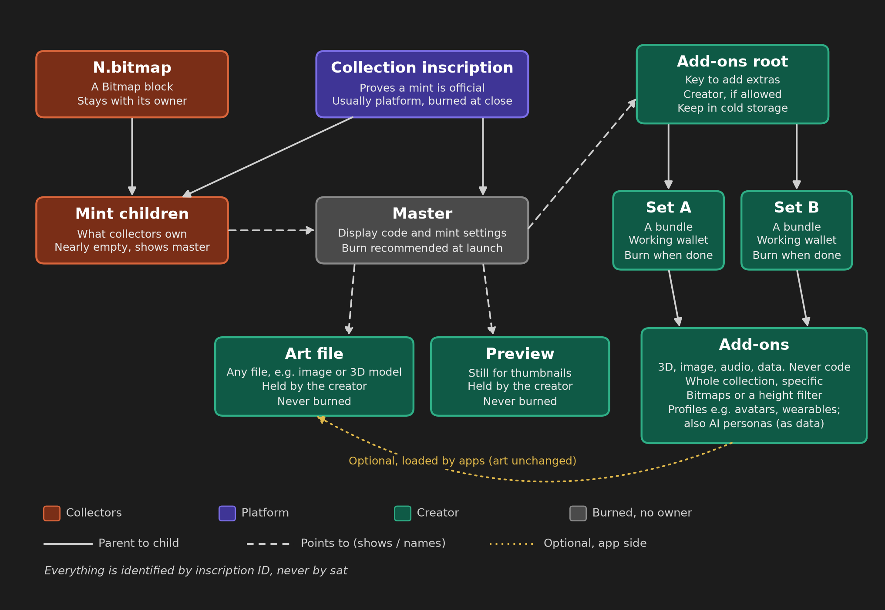
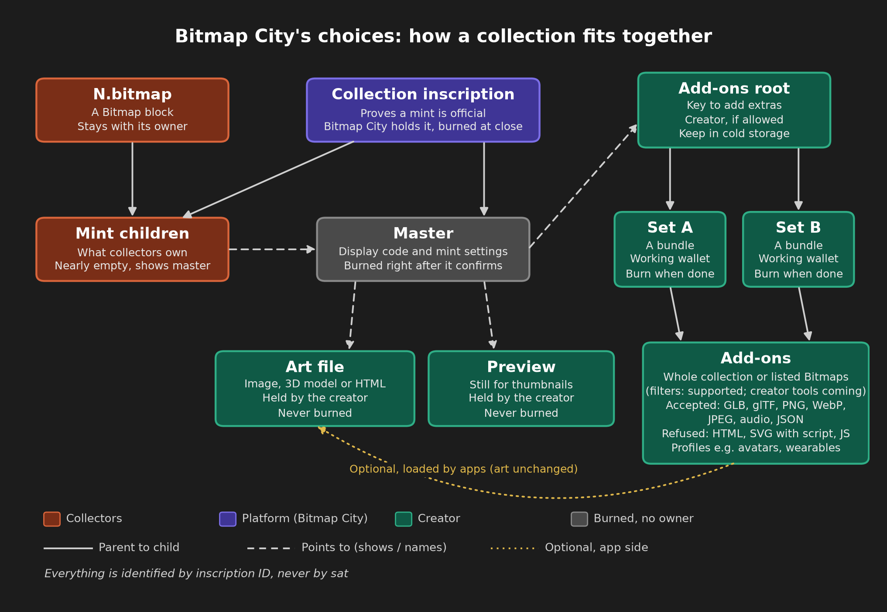

# Bitmap Asset Standard

**Version 1.0**  
November 4, 2026  
Feedback: GitHub issues in this repository

## Why this standard

Bitmap is a decentralized project. It relies solely on `N.bitmap` inscriptions, secured by the Bitcoin network, read through ord. Among the apps being built on that foundation, NFTs such as art, buildings and avatars are a natural fit for how people interact with their Bitmaps. Anyone can create and support Bitmap NFTs however they choose, and no one needs permission.

Even so, the Bitmap ecosystem benefits from a generally accepted standard for NFT minting and ownership that's easy for builders to support. The more interoperable these NFTs are, the more value can accrue to these NFTs and the Bitmap ecosystem as a whole.

This document proposes a standard with three goals: minimize trust in third parties, make it practical for builders to implement, and give creators a way to distribute, and potentially earn from NFTs that work across Bitmap apps.

Adopting it is optional. However, a platform or app that claims to conform follows its MUST rules.

Most importantly, on chain is law. A mint child that names the collection inscription as a parent is a member. For a Bitmap-holder collection, it also names a valid `N.bitmap` as a parent. Burning the collection inscription is the supply lock.

The master inscription, a child of the collection inscription, holds the display code and the creator's mint guidance, which launchpads use when deciding what to co-sign. The master inscription SHOULD be burned right after it confirms, which fixes the collection's art and mint settings for good.

An optional Add-ons root inscription lets the creator publish add-ons, such as avatar versions, sounds or AI personas, until the creator burns the Add-ons root and its sets.

## Contents

- [1\. Status](#1-status)
- [2\. Abstract](#2-abstract)
- [3\. Goals and non-goals](#3-goals-and-non-goals)
- [4\. Terminology](#4-terminology)
- [Part A. Core standard (normative, required)](#part-a-core-standard-normative-required)
- [5\. Inscriptions and references](#5-inscriptions-and-references)
    - [5.1 Collection inscription](#51-collection-inscription)
    - [5.2 Master](#52-master)
    - [5.3 Master metadata](#53-master-metadata)
    - [5.4 Mint children](#54-mint-children)
    - [5.5 Art file](#55-art-file)
    - [5.6 Preview](#56-preview)
    - [5.7 References: inscription IDs](#57-references-inscription-ids)
- [6\. Membership and mint guidance](#6-membership-and-mint-guidance)
    - [6.1 Membership: on chain is law](#61-membership-on-chain-is-law)
    - [6.2 N.bitmap: valid Bitmap claim](#62-nbitmap-valid-bitmap-claim)
    - [6.3 Collection order](#63-collection-order)
    - [6.4 Eligibility](#64-eligibility)
    - [6.5 Membership check](#65-membership-check)
    - [6.6 Closing, burns and open mints](#66-closing-burns-and-open-mints)
    - [6.7 Mint transaction layout](#67-mint-transaction-layout)
- [7\. Add-ons (optional, off by default)](#7-add-ons-optional-off-by-default)
    - [7.1 Add-ons root](#71-add-ons-root)
    - [7.2 Sets](#72-sets)
    - [7.3 Add-ons](#73-add-ons)
    - [7.4 Add-on metadata](#74-add-on-metadata)
    - [7.5 Layers, not replacements](#75-layers-not-replacements)
    - [7.6 Freeze, validity and disclosure](#76-freeze-validity-and-disclosure)
    - [7.7 Master burn](#77-master-burn)
- [8\. Enforcement summary](#8-enforcement-summary)
- [9\. Security and reader considerations](#9-security-and-reader-considerations)
- [Part B. Optional profiles (normative only when declared)](#part-b-optional-profiles-normative-only-when-declared)
- [10\. Optional profiles](#10-optional-profiles)
    - [10.1 How profiles work](#101-how-profiles-work)
    - [10.2 Profile bitmap-3d/1: model file](#102-profile-bitmap-3d1-model-file)
    - [10.3 Profile bitmap-3d/1: budgets and compression](#103-profile-bitmap-3d1-budgets-and-compression)
    - [10.4 Avatar and wearable profiles](#104-avatar-and-wearable-profiles)
- [Part C. Informative](#part-c-informative)
- [11\. Platform guidance](#11-platform-guidance)
    - [11.1 Minting and marketplace platforms](#111-minting-and-marketplace-platforms)
    - [11.2 Example: Bitmap City](#112-example-bitmap-city)
    - [11.3 Games and experiences](#113-games-and-experiences)
- [12\. For app developers: supporting the standard](#12-for-app-developers-supporting-the-standard)
    - [12.1 What an app reads](#121-what-an-app-reads)
    - [12.2 Endpoints](#122-endpoints)
    - [12.3 Conforming reader checklist](#123-conforming-reader-checklist)
    - [12.4 Reference code](#124-reference-code)
    - [12.5 Known gap: first-is-first](#125-known-gap-first-is-first)
- [13\. Worked examples](#13-worked-examples)
    - [Frozen launch with a profile](#frozen-launch-with-a-profile)
    - [Traits mint child metadata](#traits-mint-child-metadata)
    - [Mint transaction layout and pointers](#mint-transaction-layout-and-pointers)
    - [Membership check results](#membership-check-results)
    - [Add-on metadata](#add-on-metadata)
- [14\. Profile extensions under discussion](#14-profile-extensions-under-discussion)
- [15\. Open questions and watch notes](#15-open-questions-and-watch-notes)
    - [15.1 Watch note: blocators](#151-watch-note-blocators)
- [16\. License](#16-license)

## 1. Status

- **Document:** Bitmap Asset Standard: a core standard (ownership, membership, mint guidance and optional add-ons) plus optional profiles.
- **Status:** Version 1.0, first public release, November 4, 2026. Feedback via GitHub issues in this repository. App developers can start with section 12 (For app developers: supporting the standard).
- **Version history:** 1.0 (November 4, 2026): first public release.
- **Version numbers:** the master metadata `v`, profile names (for example `bitmap-3d/1`) and the `E3_LAUNCH` `version` string are independent of the version of this document.
- **License:** CC0 1.0 (section 16, License).
- **Based on:** the Bitmap base rules (the claim rule in section 6.2, N.bitmap: valid Bitmap claim), working mint code tested on signet and regtest, and feedback from Bitmap creators and builders.

MUST, MUST NOT, SHOULD, SHOULD NOT and MAY are used as in RFC 2119. Adopting this standard is completely opt-in. But for a platform or app that claims to conform, every MUST and MUST NOT is binding. SHOULD and MAY keep their RFC 2119 meaning. Nothing enforces the standard beyond Bitcoin itself (membership and burns).

**Scope of this version.** This version of the standard covers only Bitmap-holder collections, where a Bitmap (`N.bitmap`) is a parent of each mint child, alongside the collection inscription ([5.2 Master](#52-master), [6.1 Membership: on chain is law](#61-membership-on-chain-is-law)). Other collection types will be explored in future versions, which may define them.

**How the rules apply.**

- **Opt-in to adopt.** Adopting this standard is completely opt-in. No platform or app has to use it.
- **Binding once adopted.** A platform or app that claims to conform MUST apply every MUST rule that applies to it. It can't pick and choose. An app that skips one doesn't conform.
- **Membership rules come first.** **Membership rule: a mint child is part of a collection only if the collection inscription is its parent. In a Bitmap-holder collection, the only type this version defines, one valid `N.bitmap` must also be its parent. Each parent's owner must sign the reveal. Any app that conforms to this standard MUST apply this rule.** In detail: `collectionParent` is taken from the canonical master inscription, and in a Bitmap-holder collection exactly one parent is a valid `N.bitmap` (the first valid claim for N) ([6.1 Membership: on chain is law](#61-membership-on-chain-is-law), [6.5 Membership check](#65-membership-check)). The master inscription's `collectionType` names the collection type ([5.2 Master](#52-master)). A conforming app decides membership this way and no other way. The other MUST rules, such as finding the canonical master inscription ([5.2 Master](#52-master)) and reading mint child metadata ([5.4 Mint children](#54-mint-children)), are binding too.
- **Mint settings are guidance.** The per-Bitmap limit, the supply cap and the other mint settings guide whoever co-signs mints. They never decide membership, and a conforming app treats every member the same ([6.1 Membership: on chain is law](#61-membership-on-chain-is-law), including the table there).
- **What enforces it.** Nothing enforces this standard beyond Bitcoin itself. Bitcoin enforces membership (a mint child needs the collection inscription holder's signature and, in a Bitmap-holder collection, the Bitmap holder's too) and burns. No indexer, marketplace or contract enforces the rest: MUST and SHOULD say what a conforming app does; they are not a validation layer. Indexers index ord inscriptions; they don't enforce this standard.
- **The one outside input.** In a Bitmap-holder collection, the first-is-first Bitmap claim ([6.2 N.bitmap: valid Bitmap claim](#62-nbitmap-valid-bitmap-claim)) comes from an indexer the platform chooses to trust.
- **Why builders adopt it.** Builders adopt the standard only if it helps: less work, better performance, simpler code, or what their users ask for. Reference code, open example code inscribed on chain that any viewer can load, is optional and enforces nothing ([12.4 Reference code](#124-reference-code)).

The document has three parts. Part A, the core standard (sections 5–9), is normative and applies to every collection. Part B, the optional profiles (section 10), is normative only for a collection or add-on that declares a profile. Part C (sections 11–15) is informative.

## 2. Abstract

The Bitmap Asset Standard is an open way to own and mint items for the Bitmap ecosystem on Bitcoin, as inscriptions, using modern features of ord, the ordinals indexer and explorer, and no outside server. In a Bitmap-holder collection, each item belongs to a Bitmap, `N.bitmap`.

On chain is law. A mint child is a member of a collection when it names, on chain, the collection inscription as a parent. In a Bitmap-holder collection, the only type this version defines, it must also name a valid `N.bitmap` as a parent. Naming a parent takes its holder's signature, so Bitcoin itself enforces membership. Burning the collection inscription when the mint closes is the real supply lock ([6.6 Closing, burns and open mints](#66-closing-burns-and-open-mints)).

Each collection has one master inscription, which shows the art and carries the creator's mint settings (`MINT_RULES`): the supply cap and, in a Bitmap-holder collection, the eligible Bitmaps and the per-Bitmap limit. Platforms SHOULD follow these mint settings when deciding what to co-sign. But on chain is law: only the parents decide membership. The mint settings are guidance; they never decide membership, and readers never use them to exclude or mark an item: every member counts the same, and the supply shown is the number of members. Anyone can check membership through ord recursion, without trusting any one indexer ([6.1 Membership: on chain is law](#61-membership-on-chain-is-law), [6.5 Membership check](#65-membership-check)). By guidance, each item is a tiny, empty delegate child of the master inscription with a few bytes of CBOR (Concise Binary Object Representation) metadata.

The creator is ultimately responsible for the collection's inscriptions and their burns. A creator can make them personally, but generally hands that responsibility to a platform, which then inscribes and burns on the creator's behalf.

The master inscription SHOULD be burned right after it confirms, so the collection's art and mint settings are fixed forever and collectors know their items can't be changed; the mint children still render ([7.7 Master burn](#77-master-burn)). The art file inscription and the preview inscription always belong to the creator and are never burned ([5.5 Art file](#55-art-file), [5.6 Preview](#56-preview)).

A launch MAY also name an Add-ons root inscription. It gives the creator the option to enhance the collection, or parts of it, over time, with add-ons such as avatar versions, sounds or AI personas. There is an on-chain link: the master inscription names the Add-ons root inscription, add-on sets are its children, and add-ons are children of the sets. No add-on is a child of the art file inscription or the master inscription, add-ons never alter the minted art, and apps MAY load them ([7.5 Layers, not replacements](#75-layers-not-replacements)). A launch that names no Add-ons root is frozen from launch, which is the default.

The standard is about ownership, not file formats. It does not require or exclude any file format, so creators keep maximum freedom. Instead it gives guidance to platforms, meaning minting and marketplace platforms and games and other experiences, on which file formats and file constraints they should support for maximum interoperability, based on common practice. The collection metadata stays tiny and rendering is left to each app.

The standard is open to every creator and every platform. Fees, caps and other policies are set by each platform, outside the standard.

This standard depends only on the Bitmap base rules, the claim rule in section 6.2 (N.bitmap: valid Bitmap claim), and takes no position on Bitmap governance.

## 3. Goals and non-goals

### Goals

This version of the standard covers Bitmap-holder collections, where a Bitmap (`N.bitmap`) is a parent of each mint child (section 1, Status).

1. Bitcoin enforces what matters: membership needs the collection inscription holder's signature (and, in a Bitmap-holder collection, the Bitmap holder's), and every lock is a burn: the collection inscription for supply, the master inscription for the art and mint settings, and the Add-ons root inscription and each set for add-ons.
2. Anyone can verify through recursion: one deterministic membership check, with the same result from the master inscription, an indexer or a third-party reader. Adopting it is opt-in, but a conforming reader runs it. It helps builders agree; it does not enforce anything.
3. Cheap mints: an empty body plus about 17–40 bytes of metadata per item.
4. Room for creativity: an item's art file can be any content type, and interoperability between worlds comes from optional, opt-in profiles and platform guidance.
5. Tiny collection metadata (in the master inscription, [5.3 Master metadata](#53-master-metadata)), rendering left to apps, with optional reference code that shows one way to read the data ([12.4 Reference code](#124-reference-code)).
6. Extensible without breaking: optional versioned profiles, and new kinds of assets such as avatars arrive as add-ons; readers ignore unknown names.
7. Open to every creator, launchpad and world. Interoperability is a goal, not a claim.

### Non-goals

- Turning mint guidance into a membership test: the mint settings (`MINT_RULES`) and the master metadata never decide membership ([6.1 Membership: on chain is law](#61-membership-on-chain-is-law)).
- Defining avatar and wearable formats: the profile names are reserved, and avatar and wearable versions of a collection come as add-ons ([10.4 Avatar and wearable profiles](#104-avatar-and-wearable-profiles)).
- Placement inside a world: the owner's build decides; worlds only load and scale items ([10.2 Profile bitmap-3d/1: model file](#102-profile-bitmap-3d1-model-file)).
- Holder whitelists or allow-lists: platform-only, never in the standard or the on-chain rules.
- Parallel mint queues: a platform concern, outside the standard.
- Fees, prices, payouts, mint windows and other launch rules: each platform's own terms, outside the standard ([11.1 Minting and marketplace platforms](#111-minting-and-marketplace-platforms)).
- A renderer: the standard ships none.
- Bitmap governance: the standard takes no position ([2 Abstract](#2-abstract)).
- Other collection types: out of scope for this version; they will be explored in future versions ([6.1 Membership: on chain is law](#61-membership-on-chain-is-law)).

## 4. Terminology

Terms follow the labels in Figure 1 ([5 Inscriptions and references](#5-inscriptions-and-references)).

| Term | Meaning |
| --- | --- |
| `N.bitmap` | A text inscription whose body is exactly `N.bitmap` for block height N |
| Valid Bitmap claim | The first `N.bitmap` inscription for N that passes the claim rule ([6.2 N.bitmap: valid Bitmap claim](#62-nbitmap-valid-bitmap-claim)) |
| Collection inscription | A small inscription that defines the collection and proves a mint is official. It is the parent of the master inscription and of every mint child; its holder, usually the platform the creator designates, co-signs mints, and burning it closes the collection for good ([5.1 Collection inscription](#51-collection-inscription)). |
| Collection type | The type of a collection, named by `collectionType` in the master inscription ([5.2 Master](#52-master)). This version defines one type, the Bitmap-holder collection (`bitmap-holders`), whose mint children each name a valid `N.bitmap` as a parent. |
| Bitmap-holder collection | A collection whose mint children each name one valid `N.bitmap` as a parent, alongside the collection inscription. Its `collectionType` is `bitmap-holders`, or missing. It is the only collection type this version defines ([5.2 Master](#52-master), [6.1 Membership: on chain is law](#61-membership-on-chain-is-law)). |
| Member | A mint child that names, among its parents on chain, the collection inscription and, in a Bitmap-holder collection, exactly one `N.bitmap`, which is a valid Bitmap claim ([6.1 Membership: on chain is law](#61-membership-on-chain-is-law)). Membership is the ground truth. |
| Master inscription (master) | One `text/html` inscription per collection, a child of the collection inscription, holding the display code, the mint settings (`MINT_RULES`), `E3_LAUNCH` and the membership check code, with the collection info in its ord metadata ([5.2 Master](#52-master)). It never decides membership and is never a member. It SHOULD be burned right after it confirms ([7.7 Master burn](#77-master-burn)). |
| Mint guidance | The master inscription's mint settings (`MINT_RULES`): its limits (supply cap, per-Bitmap limit, eligibility, delegate, metadata): what launchpads use when deciding what to co-sign. Never a membership input ([6.1 Membership: on chain is law](#61-membership-on-chain-is-law)). |
| Mint child (child, item) | An inscription naming the collection inscription as a parent and, in a Bitmap-holder collection, its `N.bitmap` too ([5.4 Mint children](#54-mint-children)). By guidance it is empty, delegates to the master inscription and carries CBOR metadata. Collectors hold mint children. |
| Art file (art file inscription) | The inscription the master inscription renders, named by `assetId`, of any content type ([5.5 Art file](#55-art-file)). It always belongs to the creator and is never burned. |
| Preview (preview inscription) | An inscription holding a still image of the item for thumbnails and lists, named by `previewId` ([5.6 Preview](#56-preview)). It always belongs to the creator and is never burned. |
| Master metadata | The collection info (name, creator, art file, preview, profiles, launch setting, Add-ons root and so on), as CBOR in the master inscription's ord metadata field ([5.3 Master metadata](#53-master-metadata)). Never a membership input. |
| Add-ons root (Add-ons root inscription) | An optional small inscription, held by the creator, whose children are add-on sets; named by the master inscription as `addonsRoot`. The collection's only long-lived key ([7.1 Add-ons root](#71-add-ons-root)). |
| Set (add-on set) | A bundle: a child of the Add-ons root whose children are add-ons; burning it ends that set ([7.2 Sets](#72-sets)) |
| Add-on | A child of a set: an extra, recommended to be a data file, never code, that apps MAY load alongside the art ([7.3 Add-ons](#73-add-ons)). Its metadata says what it applies to ([7.4 Add-on metadata](#74-add-on-metadata)). It is never a member. |
| Burn | Sending an inscription to a valued `OP_RETURN` output, so it can never move again; ord marks it `burned` ([6.6 Closing, burns and open mints](#66-closing-burns-and-open-mints)) |
| Open mint | A collection whose collection inscription is never burned, so its supply is never locked ([6.6 Closing, burns and open mints](#66-closing-burns-and-open-mints)) |
| Fully frozen collection | A collection that can never change, because of burns: its master inscription is burned, and its Add-ons root and every set are burned, or the launch named no Add-ons root ([7.6 Freeze, validity and disclosure](#76-freeze-validity-and-disclosure)) |
| Collection tag | The `f` value every mint child carries, e.g. `BM10a1b2c3d4e` |
| K | `perBitmap`: the mint guidance limit of mint children per Bitmap, in a Bitmap-holder collection |
| Result | The outcome of the membership check: member, not a member (with one reason), could not verify, or unsupported collection type ([6.5 Membership check](#65-membership-check)) |
| Collection order | The order of the collection inscription's children by ord sequence, also called sibling order ([6.3 Collection order](#63-collection-order)) |
| Edition / Traits | One fixed art file for every mint child, or, in a Bitmap-holder collection, art derived from the Bitmap's block data |
| Profile | An optional, named and versioned set of shared conventions (such as a recommended file format, units or scaling), declared in `profiles` by the master metadata for the launch art file, or by an add-on for itself ([10.1 How profiles work](#101-how-profiles-work)) |
| Filter | A rule on the Bitmap block height alone, built from the tests in [6.4 Eligibility](#64-eligibility) (such as a range, a remainder or a digit mask). The one grammar for picking Bitmaps: `eligible` uses it, and so does an add-on's `scope` ([6.4 Eligibility](#64-eligibility), [7.4 Add-on metadata](#74-add-on-metadata)) |
| Stored bytes | The inscription body's length as inscribed, after any content-encoding (tag 9), per file. Size limits in this standard count stored bytes ([5.6 Preview](#56-preview), [10.3 Profile bitmap-3d/1: budgets and compression](#103-profile-bitmap-3d1-budgets-and-compression)) |
| Inscription ID | The ord identifier `<txid>i<n>`; the only way this standard identifies an inscription, never a sat ([5.7 References: inscription IDs](#57-references-inscription-ids)) |
| Reference code | Open, inscribed example code that shows one way to read Bitmap assets correctly. Optional and never enforced; the standard is the rules ([12.4 Reference code](#124-reference-code)) |

## Part A. Core standard (normative, required)

Sections 5–9 apply to every collection. They cover inscriptions, ownership and membership, the master inscription and its mint guidance, mint children and their CBOR metadata, references, the claim rule, the membership check, closing, open mints, the mint transaction layout, and optional add-ons.

## 5. Inscriptions and references



*Figure 1. How a collection fits together, shown for a Bitmap-holder collection, the only type this version defines. Solid arrows run from parent to child: the child names the parent on chain. Dashed arrows mean "points to" by inscription ID: a mint child delegates to the master inscription, and the master inscription names the art file, the preview and the Add-ons root. The gold dotted line is optional and app side only: apps may load add-ons alongside the art file, which stays unchanged. Colors show who holds each inscription: collectors (orange), the platform (purple), the creator (green), or no one because it is burned (gray). The labels use the standard's generic wording: burns are recommended, and the art file and the preview are held by the creator, never burned ([5.5 Art file](#55-art-file)). Add-ons are linked on chain through the sets and the Add-ons root, never through the art file or the master inscription ([7.5 Layers, not replacements](#75-layers-not-replacements)).*

### 5.1 Collection inscription

The collection inscription defines the collection and proves a mint is official. It is a small inscription, inscribed and confirmed before the master inscription. It is the parent of the master inscription ([5.2 Master](#52-master)) and of every mint child ([5.4 Mint children](#54-mint-children)), and membership comes first from it, and in a Bitmap-holder collection also from a valid `N.bitmap` ([6.1 Membership: on chain is law](#61-membership-on-chain-is-law)).

- Holder: the creator is responsible for it. Usually the platform the creator designates holds it during the mint and co-signs every mint, because a mint spends it as a parent. A creator MAY hold it and mint themselves. Whoever holds it controls future supply, which is a key risk for as long as it is held ([9 Security and reader considerations](#9-security-and-reader-considerations)).
- Closing: burning it when the mint closes is the supply lock and the recommended end state. A collection whose collection inscription is never burned is an open mint ([6.6 Closing, burns and open mints](#66-closing-burns-and-open-mints)).
- Holder changes: the collection inscription MAY move, for example from a platform to the creator or to another platform. Membership and collection order don't change when it moves; only who can co-sign future mints changes ([11.1 Minting and marketplace platforms](#111-minting-and-marketplace-platforms)).
- Content: its content is not read by the membership check; readers never fetch it to decide a result. It is referenced only by its inscription ID, including in `MINT_RULES.collectionParent`.

*Template: the collection inscription.*

```
Content type (tag 1):  text/plain;charset=utf-8
Body:                  <COLLECTION_NOTE> (any short text/plain note)
```

### 5.2 Master

The master inscription shows the collection's art and states its mint guidance; it does not decide membership ([6.1 Membership: on chain is law](#61-membership-on-chain-is-law)). The master inscription MUST be one `text/html;charset=utf-8` inscription. It holds the display code and the mint settings (`MINT_RULES`), and its ord metadata carries the collection info ([5.3 Master metadata](#53-master-metadata)). It MAY use `content-encoding: br` (tag 9); readers MUST decode it before reading the mint settings. It MUST contain exactly one `MINT_RULES` object between `/*MINT-RULES-BEGIN*/` and `/*MINT-RULES-END*/`. Apart from `collectionParent`, which names the collection inscription used by the membership check, and `parentPattern`, which the check uses to find the `N.bitmap` parent in a Bitmap-holder collection, its fields are mint guidance or fixed values ([6.1 Membership: on chain is law](#61-membership-on-chain-is-law)):

| Field | Meaning |
| --- | --- |
| `collection` | The tag every mint child's `f` should equal (mint guidance) |
| `heightKey` | MUST be `'h'` |
| `parentPattern` | MUST be `'^(0\|[1-9][0-9]*)\\.bitmap$'` |
| `collectionParent` | The collection inscription's inscription ID. MUST be set, to the master inscription's own parent. |
| `minHeight` / `maxHeight` | Eligible N, inclusive; null max = tip (mint guidance; Bitmap-holder collections) |
| `eligible` | Optional Bitmap filter ([6.4 Eligibility](#64-eligibility); mint guidance; Bitmap-holder collections) |
| `perBitmap` | K, integer ≥ 1, default 1 (mint guidance; Bitmap-holder collections) |
| `claimAtOrAfterN` | `true`: the mint child should be inscribed in block ≥ N (mint guidance; Bitmap-holder collections) |
| `closeHeight` | Optional mint guidance; SHOULD be `null`, because the burn of the collection inscription is the lock |
| `supplyCap` | The most mint children a launchpad should co-sign in total, or null (mint guidance; never the displayed supply) |
| `requireDelegate` | `true` (mint guidance) |
| `bitmapFirstIsFirst` | MUST be `true`. Readers ignore its value: in a Bitmap-holder collection, the membership check always requires the first valid claim for N ([6.1 Membership: on chain is law](#61-membership-on-chain-is-law), [6.2 N.bitmap: valid Bitmap claim](#62-nbitmap-valid-bitmap-claim)), so a master inscription that sets anything else gets the same membership result |

- Master inscription is a child of the collection inscription: it MUST name the collection inscription as its only parent (tag 3). It is never a member and never counts toward `perBitmap` or the supply; in a Bitmap-holder collection, it also names no `N.bitmap`.
- Exactly one master inscription: a master child is a child of the collection inscription that names it as its only parent and contains a `MINT_RULES` block. If more than one exists, the first in collection order ([6.3 Collection order](#63-collection-order)) is the master inscription, and readers MUST ignore the others.
- The master inscription MUST contain `E3_LAUNCH = {type, version, fields?, launchSetting, addonsRoot?, collectionType?}`: `type` is `edition` or `traits`; `version` is a version string chosen by the platform that builds the master inscription; `fields` lists Traits extra fields; `launchSetting` is `frozen` or `addons-allowed`, the same value as in the master metadata ([5.3 Master metadata](#53-master-metadata)); `addonsRoot` is the inscription ID of the Add-ons root ([7.1 Add-ons root](#71-add-ons-root)), present only when `launchSetting` is `addons-allowed`; `collectionType` is the collection type (below).
- Collection type: `collectionType` names the collection's type, in `E3_LAUNCH` and with the same value in the master metadata ([5.3 Master metadata](#53-master-metadata)). This version defines one value, `bitmap-holders`: a Bitmap-holder collection, whose mint children each name one valid `N.bitmap` as a parent ([6.1 Membership: on chain is law](#61-membership-on-chain-is-law)). A missing or null `collectionType` means `bitmap-holders`, so existing master inscriptions made before this field stay valid. Any other value, including a value that isn't text (other than null), is an unknown type. If the master metadata's value differs, readers use the `E3_LAUNCH` value ([5.3 Master metadata](#53-master-metadata)). The membership check reads the value in the canonical master inscription's `E3_LAUNCH`. An app MUST NOT treat children of a collection with an unknown `collectionType` as members or as non-members; it shows the collection as unsupported (`UNSUPPORTED_TYPE`, [6.5 Membership check](#65-membership-check)). Example: `"collectionType": "bitmap-holders"`.
- The master inscription SHOULD embed the membership check code ([6.5 Membership check](#65-membership-check)) verbatim, so it can check its own children through recursion, and SHOULD identify each embedded code block by its sha256 hash so readers can confirm which code it runs.
- An inscription's content can never change, so new art or mint settings MUST be a new master inscription and a new collection ([6.6 Closing, burns and open mints](#66-closing-burns-and-open-mints), Starting over). The master inscription SHOULD be burned right after it confirms, so nobody holds it and collectors know their items can't change ([7.7 Master burn](#77-master-burn)).
- The collection inscription MUST be inscribed and confirmed before the master inscription, and the master inscription's ord sequence MUST be after it. Inscribing the master inscription as its child spends the collection inscription, so its holder signs.
- The master inscription SHOULD draw as soon as N is known, run the membership check in the background, and overlay only a definite result (never `UNVERIFIED`), and no banner in the two cases in [7.7 Master burn](#77-master-burn) (`NO_PARENT`, and the master inscription viewed on its own). It shows every member the same way ([6.1 Membership: on chain is law](#61-membership-on-chain-is-law)).
- The master inscription MUST use only `/content/` and `/r/` paths, with no outside calls, and MUST NOT read or load add-ons ([7.5 Layers, not replacements](#75-layers-not-replacements)).

### 5.3 Master metadata

The collection info lives in the master inscription's ord metadata field (tag 5), as CBOR. Marketplaces and indexers read it in one call, `/r/metadata/<master id>`. It describes the collection; it is never a membership input.

```
{ name, description, creator, collectionTag, assetId, format, previewId?, profiles?,
  colliders?, launchSetting, addonsRoot?, collectionType?, v: 1 }
```

| Field | Meaning |
| --- | --- |
| `name` | The collection's name |
| `description` | A short description, may be empty |
| `creator` | Who made the collection: a name or an address the creator chooses |
| `collectionTag` | The tag; SHOULD equal `MINT_RULES.collection` and every mint child's `f` |
| `assetId` | The inscription ID of the art file inscription, which the master inscription renders ([5.5 Art file](#55-art-file)). The field name is kept for compatibility. |
| `format` | The art file's standard content type (MIME type), for example `model/gltf-binary`, `image/png` or `text/html`. VRM has no registered type yet; the avatar profile will pin the one it uses ([10.4 Avatar and wearable profiles](#104-avatar-and-wearable-profiles)). |
| `previewId` (optional) | The inscription ID of the preview inscription ([5.6 Preview](#56-preview)) |
| `profiles` (optional) | Profiles the art file follows, e.g. `["bitmap-3d/1"]` for a GLB that follows the 3D conventions. Describes only the launch art file ([10.1 How profiles work](#101-how-profiles-work)). |
| `colliders` (optional) | Only for an Edition: one collection-wide collider for the art file, in the form defined in [10.2 Profile bitmap-3d/1: model file](#102-profile-bitmap-3d1-model-file). Per-item colliders never go here. |
| `launchSetting` | `frozen` (the default) or `addons-allowed` ([7.6 Freeze, validity and disclosure](#76-freeze-validity-and-disclosure)) |
| `addonsRoot` (optional) | The Add-ons root inscription's inscription ID, as named in `E3_LAUNCH`. Left out when the launch is frozen ([7.1 Add-ons root](#71-add-ons-root)) |
| `collectionType` (optional) | The collection type, the same value as in `E3_LAUNCH`: `bitmap-holders`, the only type this version defines. Missing or null means `bitmap-holders` ([5.2 Master](#52-master)). For listing and display; the membership check reads `E3_LAUNCH`. |
| `v` | The schema version (1) |

- `format` MUST state the art file's real content type. Readers MUST NOT reject the metadata for a type they don't support; they MAY skip rendering it.
- Readers MUST ignore unknown profile names and MUST NOT reject the metadata because of them.
- The master metadata SHOULD stay under 1 KB and MUST NOT carry rendering hints (lights, cameras, extra materials).
- A reader seeing a higher `v` SHOULD still read the fields it knows, and MUST ignore unknown keys.
- Mismatch with `E3_LAUNCH`: if a value in the master metadata differs from the same field in `E3_LAUNCH`, readers MUST use the `E3_LAUNCH` value and MAY flag the mismatch. A mismatch alone does not make a collection malformed or unsupported.
- Absent optional keys: an optional key that doesn't apply is left out, never written as null. For example, a frozen launch has no `addonsRoot` key. Readers MUST treat a missing key and a null value the same.
- The master metadata SHOULD declare `profiles` for the launch art file when it follows one, for example `["bitmap-3d/1"]` ([10 Optional profiles](#10-optional-profiles)). Profiles are optional; most art files follow none.
- No price, mint window or payout goes in the master metadata.

*Template: the master inscription ([5.2 Master](#52-master), [5.3 Master metadata](#53-master-metadata)).*

```
Content type (tag 1):  text/html;charset=utf-8
Parent (tag 3):        <COLLECTION_ID>i0
Metadata (tag 5):      CBOR, shown as JSON:
  { "name": "<COLLECTION_NAME>", "description": "<DESCRIPTION>",
    "creator": "<CREATOR>", "collectionTag": "<COLLECTION_TAG>",
    "assetId": "<ART_ID>i0", "format": "text/html", "previewId": "<PREVIEW_ID>i0",
    "launchSetting": "addons-allowed", "addonsRoot": "<ADDONS_ROOT_ID>i0",
    "collectionType": "bitmap-holders", "v": 1 }
Body (abbreviated):
  <!doctype html> … <iframe id="art" src="/content/<ART_ID>i0" sandbox=""> …
  /*MINT-RULES-BEGIN*/
  const MINT_RULES = {
    "collection": "<COLLECTION_TAG>", "heightKey": "h",
    "parentPattern": "^(0|[1-9][0-9]*)\\.bitmap$",
    "collectionParent": "<COLLECTION_ID>i0",
    "minHeight": 0, "maxHeight": null, "eligible": null, "perBitmap": 1,
    "claimAtOrAfterN": true, "closeHeight": null, "supplyCap": 21,
    "requireDelegate": true, "bitmapFirstIsFirst": true };
  /*MINT-RULES-END*/
  const E3_LAUNCH = {"type": "edition", "version": "<PLATFORM_VERSION>",
    "launchSetting": "addons-allowed", "addonsRoot": "<ADDONS_ROOT_ID>i0",
    "collectionType": "bitmap-holders"};
  /*MAKEIO-BEGIN*/ … /*MAKEIO-END*/   /*VALIDATE-BEGIN*/ … /*VALIDATE-END*/
  … display code: window.E3 = {valid, code, …}; overlay only a definite result: valid false,
    not NO_PARENT, not the master viewed on its own (7.7) …
In-page result:        steps 1-5 pass and step 6 not checked: valid null, code UNVERIFIED
                       (6.5); readers show the indexer's result
```

### 5.4 Mint children

A mint child is the item a collector owns. Its parent tags decide membership ([6.1 Membership: on chain is law](#61-membership-on-chain-is-law)); everything else about it is guidance.

| Envelope field (ord tag number) | Value |
| --- | --- |
| Parent (tag 3) | Membership: the collection inscription and, in a Bitmap-holder collection, exactly one `N.bitmap`, the holder's ([6.1 Membership: on chain is law](#61-membership-on-chain-is-law)). Guidance: write exactly these, in either order. |
| Delegate (tag 11) | Guidance: the master inscription's inscription ID |
| Metadata (tag 5) | Guidance: CBOR map, schema below |
| Content type (tag 1) | Guidance: optional |
| Body | Guidance: empty |
| Pointer (tag 2) (MAY) | The mint child's own output ([6.7 Mint transaction layout](#67-mint-transaction-layout)) |
| Metaprotocol (tag 7) (MAY) | A platform MAY write its own metaprotocol name; readers MUST NOT require it |

| Key | Guidance |
| --- | --- |
| `f` | Text; SHOULD equal `MINT_RULES.collection` |
| `h` | Unsigned int; in a Bitmap-holder collection, SHOULD equal N of the Bitmap parent. On a mismatch the parent decides N. |
| Extras (Traits only) | Name: a letter then up to 7 of `[a-z0-9_]`, not `f`/`h`. Value 1–32 bytes, no control, bidi or zero-width characters. All extras add at most 64 bytes, at most 8 fields. Platforms MAY allow fewer. |

- Platforms SHOULD write every mint child as this section describes. A mint child that departs from it is still a member, treated like any other, if it meets the membership rule ([6.1 Membership: on chain is law](#61-membership-on-chain-is-law)).
- Edition mint children SHOULD be exactly `{f, h}`. The membership check never reads metadata, so extras never change a result. K is never in metadata. Readers MUST ignore unknown keys.
- Mint children delegate content only, so they never inherit the master metadata or its `profiles`.
- Two parent tags make ord curse the mint child (`duplicate_field`) before the jubilee; past it they are vindicated. Readers MUST NOT drop them and MUST read every parent tag, because in a Bitmap-holder collection membership depends on both.
- No fee, price or payment field goes in a mint child, the master inscription or any other inscription this standard defines.

*Template: a mint child on 840000.bitmap.*

```
Content type (tag 1):  none
Parent (tag 3):        <BITMAP_840000_ID>i0
Parent (tag 3):        <COLLECTION_ID>i0
Delegate (tag 11):     <MASTER_ID>i0
Pointer (tag 2):       1092, bytes 4404 (single mint, 546-sat inputs; 6.7)
                       4404 is 1092 as little-endian hex (0x0444 → 44 04)
Metadata (tag 5):      {"f": "<COLLECTION_TAG>", "h": 840000}, as CBOR
Body:                  empty
Result:                indexer MEMBER; in-page check UNVERIFIED, valid null (6.5)
```

### 5.5 Art file

The art file inscription is the file the master inscription renders, named by `assetId` in the master metadata. It can be any content type, for example an image, a 3D model or HTML. The master inscription's HTML view is the live view of the art, opaque by default, transparent only on request.

- Source: the art file MAY be inscribed for the launch, or the master inscription MAY point to an inscription the creator already owns, for example an existing 1/1 used as the art for an edition. Both are handled the same way.
- Custody: the art file inscription always belongs to the creator. A platform that creates it at launch SHOULD inscribe it so the new inscription lands directly in the creator's wallet (the platform never takes custody) and MUST NOT keep holding it. An art file the creator already owns stays where it is. Art files are never burned: the art can't change either way.
- Why no burn: an inscription's content is fixed, and every item shows the art by inscription ID, so whoever holds the art file can't change what the collection shows. Children of the art file are never members or add-ons (below), and a reinscription on its sat is ignored, because readers go by inscription ID ([5.7 References: inscription IDs](#57-references-inscription-ids)). Selling it is fine, since it is the creator's original. Burning it would lock nothing more: a collection can never change once its master inscription is burned and no add-ons are possible, because the Add-ons root and every set are burned or the launch named no Add-ons root ([7.6 Freeze, validity and disclosure](#76-freeze-validity-and-disclosure)).
- Showing the holder: readers MAY show "Art file held by the creator".
- Children of the art file: anything inscribed as a child of the art file is never a member and never an add-on. Membership comes only from the parents ([6.1 Membership: on chain is law](#61-membership-on-chain-is-law)), and add-ons come only through the Add-ons root ([7.3 Add-ons](#73-add-ons)).

*Template: the art file inscription (an Edition: one art file for every member).*

```
Content type (tag 1):  text/html;charset=utf-8
Body (abbreviated):    <!doctype html> … <svg … aria-label="<COLLECTION_NAME>"> … </svg> …
```

### 5.6 Preview

The preview inscription is a still image of the item for thumbnails and lists, named by `previewId` in the master metadata.

- A collection SHOULD provide a preview, so marketplaces can render each mint child as an individual image.
- Format: previews SHOULD be WebP or PNG. Any image type MAY be used; platforms also accept JPEG, GIF and AVIF.
- Size: previews SHOULD be at most 512 px on the long side, opaque, and at most 50 KB of stored bytes ([4 Terminology](#4-terminology)).
- Custody: like the art file inscription ([5.5 Art file](#55-art-file)), the preview inscription always belongs to the creator. A platform that creates it at launch SHOULD inscribe it so it lands directly in the creator's wallet and MUST NOT keep holding it; a preview the creator already owns stays where it is. Previews are never burned. Readers MAY show "Preview held by the creator".
- The preview never changes after launch, because the master inscription never loads add-ons ([7.5 Layers, not replacements](#75-layers-not-replacements)).

*Template: the preview inscription.*

```
Content type (tag 1):  image/webp
Body (abbreviated):    <WebP image, 512 × 512 px, opaque, under 50 KB>
```

### 5.7 References: inscription IDs

This standard identifies inscriptions only by inscription ID.

- Identify by inscription ID, never by sat: readers, marketplaces, games and indexers MUST identify every inscription this standard names (the collection inscription, the master inscription, a member, the art file inscription, the preview inscription, the Add-ons root inscription, a set and an add-on) by its inscription ID, never by its sat or by "the latest inscription on a sat". Collectors hold their members and can reinscribe on the same sat, and so can the holder of any unburned inscription; a reinscription is a different inscription and never changes what the original one is, shows or means.
- Canonical form: every reference in `MINT_RULES`, the master metadata, add-on metadata, parent tags, the delegate tag and results uses the inscription ID (`<txid>i<n>`). Parent and delegate tags on chain are always inscription IDs, as ord defines them.
- Writers (creators, platforms, indexers, reference code) SHOULD write inscription IDs.

## 6. Membership and mint guidance

### 6.1 Membership: on chain is law

**Membership rule: a mint child is part of a collection only if the collection inscription is its parent. In a Bitmap-holder collection, the only type this version defines, one valid `N.bitmap` must also be its parent. Each parent's owner must sign the reveal. Any app that conforms to this standard MUST apply this rule.**

This section is the one place the membership rule is set; the rest of the document refers back to it.

**Collection types.** Membership is layered. The collection parent comes first: a mint child is a member only if the collection inscription is its parent, and only that inscription's holder can sign for it. The master inscription's `collectionType` then says what else a member needs ([5.2 Master](#52-master)). This version defines one type, the Bitmap-holder collection (`bitmap-holders`), where one valid `N.bitmap` MUST also be a parent; a missing `collectionType` means this type. An app MUST NOT treat children of a collection with an unknown `collectionType` as members or as non-members; it shows the collection as unsupported ([6.5 Membership check](#65-membership-check)). Future versions may define other collection types.

- **The rule.** A mint child is a member of a collection when, among its parents on chain, it names:
    - the collection inscription, in every collection, and
    - in a Bitmap-holder collection, exactly one `N.bitmap`, which is a valid claim: the first valid claim for block N, inscribed in block N or later, with N at or below the chain tip ([6.2 N.bitmap: valid Bitmap claim](#62-nbitmap-valid-bitmap-claim)).
- **On chain is law.** Naming the collection inscription as a parent takes its holder's signature, and in a Bitmap-holder collection naming the `N.bitmap` takes the Bitmap holder's signature too, so Bitcoin enforces membership. Nothing else decides it.
- **Copies don't count.** In a Bitmap-holder collection, a mint child whose Bitmap parent is a copy of a Bitmap (an invalid Bitmap: a later `N.bitmap` for the same N, not the first valid claim for N) is not a member. A mint child whose `N.bitmap` parent is not a valid claim for any other reason is not a member either.
- **Only one Bitmap parent.** In a Bitmap-holder collection, extra parents are fine as long as exactly one of them is a Bitmap: a child naming two or more `N.bitmap` parents is not a member.
- **Every member counts the same.** Readers, marketplaces and indexers MUST NOT flag, label, hide, delist or otherwise treat a member differently because of its mint: not for going beyond `supplyCap` or `perBitmap`, a Bitmap outside the height range or the `eligible` filter, a different or missing delegate or art link, wrong or missing metadata, extra parents that are not Bitmaps, its mint transaction layout or who held the collection inscription.
- **Supply shown is the member count.** A collection's supply is the total number of members, shown as one number. Readers MUST NOT show `supplyCap` as the supply or split the count against it.
- **Mint guidance.** The other `MINT_RULES` fields (the height range, `eligible`, `perBitmap`, `supplyCap`, `closeHeight`, `claimAtOrAfterN`, the delegate and the `f` and `h` metadata) are mint guidance, and so is the master metadata. The height range, `eligible`, `perBitmap` and `claimAtOrAfterN` apply to Bitmap-holder collections. Launchpads use them when deciding what to co-sign. Readers never use them to exclude a child. A launchpad that co-signs a mint outside them still creates a member.
- **What Bitcoin enforces.** Only membership and the burns. The real supply lock is the burn of the collection inscription ([6.6 Closing, burns and open mints](#66-closing-burns-and-open-mints)).
- The membership check ([6.5 Membership check](#65-membership-check)) applies this rule the same way for every reader. If the data it needs can't be fetched, the result is "could not verify", never "not a member".

**Membership rules and mint settings.** Only the collection-parent rule and, in a Bitmap-holder collection, the Bitmap checks below decide membership. The delegate and metadata are mint settings. This table only sorts what 6.1, 5.2 and 6.5 already say. The left column decides membership; each line gives the [6.5 Membership check](#65-membership-check) result when the rule fails. The right column never decides membership.

| Membership rules (MUST) | Mint settings (guidance for co-signers, do not decide membership) |
| --- | --- |
| **Every collection:** `collectionParent` comes from the canonical master inscription: the first master child of the collection inscription ([5.2 Master](#52-master), [6.5 Membership check](#65-membership-check)) | Supply cap, `supplyCap` |
| **Every collection:** `collectionType` is missing or `bitmap-holders`; otherwise the collection is unsupported, and no child is shown as a member or a non-member (`UNSUPPORTED_TYPE`) | The delegate (`requireDelegate`; by guidance, the master inscription) |
| **Every collection:** the mint settings name the collection inscription by inscription ID (`NOT_MEMBER`, `MALFORMED_RULES`) | Mint child metadata `f` and `h`, and Traits extras |
| **Every collection:** the mint child has at least one parent (`NOT_MEMBER`, `NO_PARENT`) | `closeHeight` |
| **Every collection:** the collection inscription, `collectionParent`, is a parent (`NOT_MEMBER`, `NO_COLLECTION_PARENT`) | The master metadata, collection order and the mint transaction layout |
| **Bitmap-holder collections:** exactly one parent is an `N.bitmap`: `text/plain`, body matching `parentPattern` (`NOT_MEMBER`, `NOT_BITMAP`) | Who held the collection inscription when the mint was signed |
| **Bitmap-holder collections:** the Bitmap's block N is at or below the chain tip (`NOT_MEMBER`, `FUTURE_BLOCK`) | Bitmap-holder collections: per-Bitmap limit, `perBitmap` (K) |
| **Bitmap-holder collections:** the `N.bitmap` was inscribed in block N or later (`NOT_MEMBER`, `BAD_BITMAP`) | Bitmap-holder collections: height range, `minHeight` and `maxHeight`, and the `eligible` filter |
| **Bitmap-holder collections:** the `N.bitmap` is the first valid claim for N, not a copy (`NOT_MEMBER`, `BITMAP_COPY`) | Bitmap-holder collections: `claimAtOrAfterN` |

If data for a step can't be fetched, the result is "could not verify" (`UNVERIFIED`), never "not a member" ([6.5 Membership check](#65-membership-check)). A mint beyond a mint setting, such as an extra mint on a Bitmap that already has K items, is still a member when the left column holds, and it counts the same as every other member. Supply shows as the member count, with "Supply not locked" until the collection inscription's burn is confirmed ([6.6 Closing, burns and open mints](#66-closing-burns-and-open-mints)).

### 6.2 N.bitmap: valid Bitmap claim

This rule defines a valid Bitmap and is part of the membership test for Bitmap-holder collections.

1. The body is exactly `/^(0|[1-9][0-9]*)\.bitmap$/` with content type `text/plain` (any charset).
2. It was inscribed in block ≥ N.
3. It is the first such inscription for N by block, then tx position, then envelope order (the Bitmap first-is-first rule, ruleset 1.5). Pointers don't reorder.
4. Unbound and pre-jubilee cursed inscriptions don't count; vindicated ones do; a reinscription never replaces the first claim.

Indexers MUST enforce rule 3 at every height. The on-chain OCI module covers blocks 0–941,999 only and master inscriptions don't load it, so the indexer result is the authority, with LiveOCI as a cross-check.

*Template: an `N.bitmap` claim.*

```
Content type (tag 1):  text/plain;charset=utf-8
Body:                  840000.bitmap
```

### 6.3 Collection order

Why it exists: some questions depend on who came first. If two master children exist, which one is the master inscription? When a launchpad applies `perBitmap` or `supplyCap` before co-signing, which earlier items does it count? Collection order gives every reader the same answer, and a stable order for listing items.

The rules:

- Collection order (also called sibling order) is ord's sequence order of the collection inscription's children: first by block, then by position in the block, then by envelope order within the transaction. It is the same order as the collection inscription's child list.
- If a collection inscription has two or more master children, the first in collection order is the master inscription; readers MUST ignore the rest ([5.2 Master](#52-master)).
- Collection order never decides membership ([6.1 Membership: on chain is law](#61-membership-on-chain-is-law)).
- The master inscription sits in the same child list, but it is never a member and never counts toward the supply (in a Bitmap-holder collection, it also names no Bitmap).
- A mint child MUST get the same result whether it was minted alone or in a batch.
- The order never changes when the collection inscription changes hands.

### 6.4 Eligibility

Why it exists: in a Bitmap-holder collection, a creator may want a collection only for certain Bitmaps, such as palindromes, round numbers, multiples of a number or a block range. The `eligible` filter states that choice in a form every tool evaluates the same way. It is mint guidance: launchpads use it to decide which Bitmaps they will co-sign on, and it never decides membership ([6.1 Membership: on chain is law](#61-membership-on-chain-is-law)).

The rules:

- `eligible` is either null (every Bitmap in the height range is eligible) or a filter built from tests on the block height N.
- Tests use only the block height N, never the block hash, the block time or any other block data, so eligibility is known before the mint.
- The tests are below. N is read in base 10 with no leading zeros; digit values are text of 1–8 digits, and a `digits` mask is text of 1–10 characters.

| Test | Form | Matches when |
| --- | --- | --- |
| `palindrome`, `prime`, `fibonacci`, `powerOf10` | `{"palindrome": true}` | N is a palindrome, a prime, a Fibonacci number or a power of 10 |
| `sameDigits` | `{"sameDigits": true}` | N has two or more digits and all of them are the same (for example 7777). A one-digit N never matches. |
| `square` | `{"square": true}` | N = k × k for some integer k (a perfect square) |
| `cube` | `{"cube": true}` | N = k × k × k for some integer k (a perfect cube) |
| `mod` | `{"mod": [m, r]}` | N mod m = r, with m ≥ 2 and r < m. `{"mod": [7, 0]}` means divisible by 7. |
| `halving` | `{"halving": true}` | Shortcut for `{"mod": [210000, 0]}` |
| `difficultyAdjustment` | `{"difficultyAdjustment": true}` | Shortcut for `{"mod": [2016, 0]}` |
| `contains`, `startsWith`, `endsWith` | `{"contains": "314"}` | N's digits contain, start with or end with the given digits |
| `digitSum` | `{"digitSum": {"eq": s}}` or `{"digitSum": {"multipleOf": k}}` | The sum of N's digits equals s, or is a multiple of k (k ≥ 1) |
| `digitAt` | `{"digitAt": [p, d]}` | The digit at position p, counted from the right starting at 1, is d (0–9). No match when N has fewer than p digits. |
| `digits` | `{"digits": "8400??"}` | N has the same number of digits as the mask, and every mask character that isn't `?` equals N's digit in the same place. The mask is 1–10 characters, each 0–9 or `?`, and MUST NOT start with 0 unless it is `"0"`. `"8400??"` matches 840000–840099. |
| `range` | `{"range": [from, to]}` | from ≤ N ≤ to; from MUST NOT be larger than to |
| `heights` | `{"heights": [h, ...]}` | N is in the list of 1 to 1,000 heights |

- Tests combine with `any` (at least one matches), `all` (every one matches) and `not` (`{"not": filter}`).
- A filter is at most 3 levels deep with at most 16 tests; a `heights` list counts as one test.
- Numbers MUST be plain unsigned integers from 0 to 2^53 − 1 (9,007,199,254,740,991). Larger numbers, floats, negative numbers and numbers written as text are malformed. Every test uses an exact integer formula (squares and cubes by integer root, never floating point), so every reader gets the same answer.
- Fail closed: a filter that breaks these rules or limits, or that a tool can't evaluate exactly, never counts as a match.
- This is the one grammar for picking Bitmaps: the same filter form selects items in an add-on's `scope` ([7.4 Add-on metadata](#74-add-on-metadata)).
- Test vectors for `eligible` accompany the reference code; the set will be extended to cover `square`, `cube`, `mod`, `digits`, `digitSum`, `digitAt`, `sameDigits` and `heights`.

These tests cover every block-height rule in a sample traits rule set (divisible by 7, 9, 47 or 69; perfect square; palindrome; contains 314, 100, 420, 888 or 300; a height range) and common Bitmap patterns. Examples (informative):

```
Divisible by 7, 9, 47 or 69:
{ "any": [ {"mod": [7, 0]}, {"mod": [9, 0]}, {"mod": [47, 0]}, {"mod": [69, 0]} ] }

Contains 314, 100, 420, 888 or 300:
{ "any": [ {"contains": "314"}, {"contains": "100"}, {"contains": "420"},
           {"contains": "888"}, {"contains": "300"} ] }

Palindromes, or 840000–849999:
{ "any": [ {"palindrome": true}, {"range": [840000, 849999]} ] }

Perfect squares that are not halvings:
{ "all": [ {"square": true}, {"not": {"halving": true}} ] }

Bitmaps 840000–840099:
{ "digits": "8400??" }
```

### 6.5 Membership check

Why it exists: marketplaces, indexers, collectors and the master inscription itself need one shared way to apply the membership rule ([6.1 Membership: on chain is law](#61-membership-on-chain-is-law)). The check runs through ord recursion, so anyone can run it without trusting any one indexer.

How it works: the input is a mint child `C`, its canonical master inscription's mint settings, `MINT_RULES` (`R`), and the collection type `T`, read from `E3_LAUNCH.collectionType` in the same master inscription (missing means `bitmap-holders`, [5.2 Master](#52-master)). The check reads only `T`, `R.collectionParent` and, in a Bitmap-holder collection, `R.parentPattern`. First, if `T` is an unknown type, stop: the result is `UNSUPPORTED_TYPE`. Next, if `R` names no collection inscription, the result is `MALFORMED_RULES`. Then run the steps in order; the first step that fails gives the reason. If a step can't fetch the data it needs, the result is "could not verify". Never guess from partial data.

Every collection:

1. **Has a parent** (`NO_PARENT`): `/r/parents/C` lists at least one parent.
2. **Has the collection inscription as a parent** (`NO_COLLECTION_PARENT`): `R.collectionParent` is a parent.

Bitmap-holder collections (`T` is `bitmap-holders`):

3. **Has exactly one N.bitmap parent** (`NOT_BITMAP`): exactly one parent other than `R.collectionParent` has content type `text/plain` (any charset) and a body matching `R.parentPattern`, and its number is N ([6.2 N.bitmap: valid Bitmap claim](#62-nbitmap-valid-bitmap-claim), rule 1). The step fails if no parent matches or if two or more do. A parent whose text matches but whose content type is not `text/plain` is not an `N.bitmap`. Never fetch the collection inscription. Other parents that are not Bitmaps don't matter.
4. **The Bitmap's block exists** (`FUTURE_BLOCK`): N is at most the chain tip (`/r/blockheight`).
5. **The Bitmap was inscribed in time** (`BAD_BITMAP`): it was inscribed in block N or later.
6. **The Bitmap is the first claim** (`BITMAP_COPY`): it is the first valid claim for N, not a copy ([6.2 N.bitmap: valid Bitmap claim](#62-nbitmap-valid-bitmap-claim)).

| Outcome | Code | When |
| --- | --- | --- |
| Member | `MEMBER` (master code MAY report `OK` only when it checked step 6) | Every step passes |
| Unsupported collection type: neither a member nor a non-member | `UNSUPPORTED_TYPE` (`valid` null) | `collectionType` is not missing and not `bitmap-holders`; the app shows the collection as unsupported |
| Not a member: malformed mint settings | `NOT_MEMBER`, `MALFORMED_RULES` | `MINT_RULES` names no collection inscription |
| Not a member: no parent | `NOT_MEMBER`, `NO_PARENT` | Step 1 fails |
| Not a member: no collection inscription parent | `NOT_MEMBER`, `NO_COLLECTION_PARENT` | Step 2 fails |
| Not a member: no N.bitmap parent, or more than one | `NOT_MEMBER`, `NOT_BITMAP` | Step 3 fails, including when the only matching text is in a parent that is not `text/plain` |
| Not a member: the Bitmap claims a future block | `NOT_MEMBER`, `FUTURE_BLOCK` | Step 4 fails |
| Not a member: the Bitmap was inscribed before its block | `NOT_MEMBER`, `BAD_BITMAP` | Step 5 fails |
| Not a member: the Bitmap is a copy | `NOT_MEMBER`, `BITMAP_COPY` | Step 6 fails |
| Could not verify | `UNVERIFIED` | Data needed for a step can't be fetched, or step 6 was not checked |

- Malformed mint settings (`MALFORMED_RULES`): if `MINT_RULES` names no collection inscription (`collectionParent` missing or not an inscription ID), the mint settings are malformed and no child is a member under them.
- The check reads nothing else: not the delegate, the mint child's metadata, the master metadata, the mint guidance or collection order, so none of them can change the result.
- `UNSUPPORTED_TYPE` is not a membership result: it means this version of the standard can't decide membership for that collection. Apps MUST NOT count, list or flag its children as members or as non-members.
- The check never reads `bitmapFirstIsFirst`: step 6 always requires the first valid claim for N, whatever the field says ([5.2 Master](#52-master)).
- Burning the master inscription never changes the result ([7.7 Master burn](#77-master-burn)).
- In-page check: the master inscription can't detect a copied Bitmap, because step 6 needs an indexer ([12.5 Known gap: first-is-first](#125-known-gap-first-is-first)). When step 6 is not checked, the master inscription MUST NOT present a definite member result: if steps 1–5 pass, it reports `valid = null` (code `UNVERIFIED`), and readers show the indexer's result. A failure at steps 1–5 is still a definite non-member result.
- The code `NO_COLLECTION_PARENT` and the field `collectionParent` keep their names for compatibility; both refer to the collection inscription.

Authority: a copied master inscription could say anything, so indexers and marketplaces MUST decide membership from the parents themselves and take `collectionParent` from the canonical master inscription: the first master child of the collection inscription ([5.2 Master](#52-master)), identified by inscription ID. Unconfirmed mint children can't be checked yet.

### 6.6 Closing, burns and open mints

This section covers the supply lock, how every burn in this standard is made and detected, and how supply is shown to users.

**Closing.** The mint closes by burning the collection inscription. The burn is the real supply lock: no mint child can name the collection inscription after it. It is final, so burn only after the last intended mint confirms. Burning is the recommended end state for every collection. Other burns (the master inscription, the Add-ons root inscription, a set) are made the same way, but none of them is a supply lock: only the collection inscription's burn stops new members.

**The burn output.** A burn sends the inscription to a valued `OP_RETURN` output, and ord charms it `burned`. An `OP_RETURN` output has no address; it is identified by its output script. The closing burn of the collection inscription, and only that burn, uses this script:

`6a126269746d61702d6d696e742d636c6f736564`

Read from the left: `6a` is the `OP_RETURN` opcode; `12` means "push the next 18 bytes" (hexadecimal 12 is 18); and the 18 bytes are the text `bitmap-mint-closed` in hexadecimal. New closing burns SHOULD use this `OP_RETURN` form. An older P2WSH burn form also exists, and readers MUST treat both forms as closed.

Every other burn (the master inscription, the Add-ons root inscription, a set) SHOULD use the neutral tag `bitmap-burn` instead, with this script:

`6a0b6269746d61702d6275726e`

Here `0b` means "push the next 11 bytes", and the 11 bytes are the text `bitmap-burn`. The tags are for people reading the transaction; they never decide whether something is burned.

*Template: a burn transaction (here, the closing burn of the collection inscription).*

```
Input 0:   <COLLECTION_ID>i0 (its UTXO, value V, signed by its holder)
Input 1:   fee UTXO
Output 0:  V sats (the whole inscription UTXO) to 6a126269746d61702d6d696e742d636c6f736564
           (OP_RETURN "bitmap-mint-closed")
Output 1:  change
Every other burn (master inscription, Add-ons root inscription, set): the same,
with output 0 to 6a0b6269746d61702d6275726e (OP_RETURN "bitmap-burn").
```

**Detecting a burn.** Readers and indexers MUST treat an inscription as burned only when ord reports the `burned` charm for it (`charms` in `/r/inscription/<id>`) or its current output is a confirmed `OP_RETURN`. They MUST count only confirmed burns, MUST NOT rely on any text in the `OP_RETURN`, and MUST treat a failed fetch as unknown, never as burned. This applies to every burn in this standard, whichever tag it carries or if it carries none; for the collection inscription, readers also accept the P2WSH form.

**Open mints.** The standard allows a collection whose collection inscription is never burned. It stays open with no close, and whoever holds the collection inscription can co-sign new mints for as long as it is unburned ([5.1 Collection inscription](#51-collection-inscription), [9 Security and reader considerations](#9-security-and-reader-considerations)).

**Supply labels.**

- Readers and marketplaces MUST NOT describe a collection's supply as locked, capped or final unless the collection inscription's burn is confirmed. In particular they MUST NOT describe an open mint's supply as locked.
- While the collection inscription is unburned, they SHOULD show "Supply not locked". Once its burn is confirmed, they MAY show "Supply locked".
- On chain, an open mint looks the same as a mint that has not closed yet, so these labels depend only on the burn, never on a platform's stated plans.

**Displayed supply.** Supply is shown as the member count ([6.1 Membership: on chain is law](#61-membership-on-chain-is-law)); the labels above depend only on the burn.

**Starting over.** Before the master inscription is inscribed, a creator who finds a mistake simply inscribes a corrected art file or preview and names it in the master inscription; the old one stays with the creator and counts for nothing. Once the master inscription exists it can't be replaced: the first master child wins ([5.2 Master](#52-master)). To start over, the creator, or a platform on the creator's behalf, burns the collection inscription with the `bitmap-mint-closed` tag, then launches a new collection with a new collection inscription and a new master inscription. This burn can be made at any time, including before the planned end; an early close is the same burn, with no new tag. Members confirmed before the burn stay members of the closed collection.

### 6.7 Mint transaction layout

Normative, for interoperability. This layout is for Bitmap-holder collections, the only type this version defines. Platforms, wallets and co-signing tools that build or sign mint transactions MUST use this layout, so that any Bitmap holder's wallet and any collection inscription holder's signer can check and sign the same transaction. The layout is not a membership input: a mint child minted with another layout is still a member if [6.1 Membership: on chain is law](#61-membership-on-chain-is-law) holds.

One reveal MAY carry several mint children, and the standard sets no cap (the 400,000 WU standard relay limit allows about 500 safely). Platforms MAY cap lower. Child j is the j-th inscription envelope in the commit input, and it names Bitmap j and the collection inscription as its parents.

| | Inputs, in order | Outputs, in order |
| --- | --- | --- |
| Single mint | 1. Bitmap; 2. collection inscription; 3. commit | 1. Bitmap returned; 2. collection inscription returned; 3. mint child (330 sats); then any payment outputs |
| Several mint children (1..N) | Bitmaps 1..N; then the collection inscription; then the commit | Each Bitmap returned (1..N, same order); then the collection inscription returned; then mint children 1..N (330 sats each); then any payment outputs |

- Returned outputs: each returned output MUST have exactly the value of the input it returns and come in the same order, so every Bitmap and the collection inscription land back at the same offset of their own output. Each Bitmap returns to its holder and the collection inscription returns to its holder (or is burned, when the mint closes).
- Fresh sats: each mint child sits at offset 0 of its own 330-sat output on a fresh sat, never on a Bitmap or collection inscription sat.
- The commit input is the reveal input that carries the inscription envelopes. It carries no existing inscription.
- Pointer: ord's pointer (tag 2) is a sat offset across all of the reveal's outputs, counted from the first sat of the first output. Let R be the sum of the values, in sats, of the returned outputs (every returned Bitmap output plus the returned collection inscription output). Numbering the mint children from 1, child j's pointer is R + 330 × (j − 1), which is the first sat of its own 330-sat output. (Numbered from 0, the same pointer is R + 330 × j.) For a single mint, the pointer is R: the Bitmap output's value plus the collection inscription output's value.
- Signatures: the Bitmap holder signs the Bitmap inputs (key path, `SIGHASH_ALL`), and the collection inscription holder signs its input. The commit input is signed through the inscription script by whoever built the commit, normally the platform. Each signer SHOULD check the whole transaction against this layout before signing ([9 Security and reader considerations](#9-security-and-reader-considerations)).
- Payment outputs are platform-specific and never affect validity or membership.
- The child envelopes sit in the last input, not the first; ord vindicates such inscriptions after the jubilee, as it does the duplicate parent tag ([5.4 Mint children](#54-mint-children)).

See [13 Worked examples](#13-worked-examples) for a worked example.

## 7. Add-ons (optional, off by default)

Add-ons let a creator publish extras for a collection after launch, such as animation clips, sounds, avatar and wearable versions, or AI personas, to enhance the whole collection or parts of it over time. They are optional, opt-in and off by default, and they never change the minted art.

### 7.1 Add-ons root

The Add-ons root inscription is the key to add extras. A launch MAY inscribe a small Add-ons root inscription before the master inscription; the master inscription names it in `E3_LAUNCH` and in the master metadata as `addonsRoot: <id>` ([5.2 Master](#52-master), [5.3 Master metadata](#53-master-metadata)). The root exists only when the launch is Add-ons allowed, and the creator holds it. A launch that names none is frozen from launch: no add-ons, ever. That is the default.

Root custody: the root is the collection's only long-lived key, because it can create new sets for as long as it is unburned. Creators SHOULD keep the root in cold storage and use it only to inscribe a new set (and finally to burn it). Nothing else ever needs the root's key. A platform that inscribes the root for a creator SHOULD transfer it to the creator.

*Template: the Add-ons root inscription.*

```
Content type (tag 1):  text/plain;charset=utf-8
Body:                  <ADDONS_ROOT_NOTE> (any short text/plain note)
```

### 7.2 Sets

The creator MAY inscribe any number of add-on sets, each a bundle, as children of the Add-ons root, at any time; add-ons are children of a set. Each set carries CBOR `{ name, kinds? }`.

| Set CBOR key | Meaning |
| --- | --- |
| `name` | The set's name |
| `kinds` (optional) | Advisory: the add-on kinds the set is meant to hold, e.g. `animation`, `avatar`, `sound` |

`kinds` is advisory. Readers MUST NOT refuse an add-on because its `kind` isn't listed in its set's `kinds`, and add-on resolution never reads `kinds` ([7.4 Add-on metadata](#74-add-on-metadata)).

Set custody: creators SHOULD inscribe each new set straight to a working (hot) wallet, use that wallet to inscribe the set's add-ons, and SHOULD burn the set once it is done. A leaked working-wallet key then exposes only that one open set, never the root or other sets.

*Template: a set inscription.*

```
Content type (tag 1):  text/plain;charset=utf-8
Parent (tag 3):        <ADDONS_ROOT_ID>i0
Metadata (tag 5):      {"name": "<SET_NAME>", "kinds": ["avatar", "sound", "persona"]}
Body:                  <SET_NOTE> (any short text/plain note)
```

### 7.3 Add-ons

An add-on is a child of a set, not directly of the root. Only the set's holder can inscribe one.

- Authority: an add-on is official only because it descends, through its set, from the Add-ons root named in the master inscription's `addonsRoot`. Files published anywhere else, including children of the art file or the master inscription, are not add-ons of the collection, whatever they declare.
- Data, not code: creators SHOULD make add-ons data files, not code: 3D (for example GLB animation clips or models), images or textures, audio, or data such as JSON. Readers MUST never execute code from an add-on, whatever its content type. Add-on code would come from whoever holds a set, not from the platform, so running it could let a hacked or malicious set drain a user's wallet, steal their data or hijack the page.
- No format ban: the standard does not ban any format, because a ban could not be enforced: whoever holds a set can inscribe anything under it. Platforms MAY set stricter rules in their own creator tools ([11.1 Minting and marketplace platforms](#111-minting-and-marketplace-platforms), [11.2 Example: Bitmap City](#112-example-bitmap-city)).
- Readers SHOULD apply the same size limits and fail-closed parsing to add-ons that they use for art files ([9 Security and reader considerations](#9-security-and-reader-considerations)).

Examples of add-ons (informative):

- Avatar versions of the items, and wearables ([10.4 Avatar and wearable profiles](#104-avatar-and-wearable-profiles))
- Game-ready models
- Alternate styles: pixel, voxel, seasonal
- Sound: themes and effects
- Lore and trait data (JSON)
- AI personas, as data only: personality, voice, backstory; never code

### 7.4 Add-on metadata

Each add-on MUST carry CBOR metadata `{ kind, scope, replaces?, profiles? }`.

| CBOR key | Meaning |
| --- | --- |
| `kind` | Text: what the add-on is, e.g. `animation`, `avatar`, `sound`. There is no fixed list; an app simply doesn't use add-ons of a kind it doesn't support, and never treats an unknown kind as an error. |
| `scope` | Which items the add-on applies to (below) |
| `replaces` (optional) | The inscription ID of one earlier add-on in the same set that this one supersedes. It removes only that one add-on, whatever its scope level, before "latest wins" is applied; it never clears a whole level. |
| `profiles` (optional) | Profiles this add-on follows, in the same `name/major` format as the master metadata's ([10.1 How profiles work](#101-how-profiles-work)) |

An add-on SHOULD declare `profiles` when it follows one, for example `["bitmap-avatar/1"]` for an avatar version ([10 Optional profiles](#10-optional-profiles)). Profiles are optional; most add-ons follow none.

*Template: an add-on (an avatar version for the whole collection).*

```
Content type (tag 1):  model/gltf+json
Parent (tag 3):        <SET_ID>i0
Metadata (tag 5):      {"kind": "avatar", "scope": "collection",
                        "profiles": ["bitmap-avatar/1"]}
Body (abbreviated):    {"asset":{"version":"2.0","generator":"<GENERATOR>"}, … }
```

Why scope is required: the common case for games is a 3D model or animation for one specific item, not the whole collection. Without a declared scope, two games would interpret the same add-on differently, which breaks interoperability. In a Bitmap-holder collection, every member is tied to one `N.bitmap`, so the Bitmap height N (decided by the member's Bitmap parent, [5.4 Mint children](#54-mint-children)) is the item identifier. Scope uses N and nothing else: never trait values, other metadata or off-chain data.

A scope takes exactly one of three forms:

- **The whole collection.** Applies to every member. Example: `"collection"` on a walk clip for every item. An app uses it for any item that has no more specific add-on of the same kind.
- **Specific Bitmaps.** Applies to the members on the listed Bitmap heights, 1 to 1,000 of them. Example: `[840000, 840021]` for custom models of the items on 840000.bitmap and 840021.bitmap. An app uses it for those items ahead of any filter or collection-wide add-on. With `perBitmap` above 1, one height can cover more than one item.
- **A filter.** Applies to the members whose Bitmap height passes a filter, written as `{ "filter": <filter> }`. The filter is exactly the one defined in [6.4 Eligibility](#64-eligibility), with the same tests, combinators and limits as `eligible`. Examples: `{ "filter": { "digits": "8400??" } }` for every Bitmap from 840000 to 840099, and `{ "filter": { "any": [ {"mod": [7, 0]}, {"square": true} ] } }` for every Bitmap divisible by 7 or a perfect square. An app uses a match ahead of any collection-wide add-on.

*Template: a filter-scoped add-on (an AI persona as data for Bitmaps 840000–840099).*

```
Content type (tag 1):  application/json
Parent (tag 3):        <SET_ID>i0
Metadata (tag 5):      {"kind": "persona", "scope": {"filter": {"digits": "8400??"}}}
Body (abbreviated):    {"name": "<PERSONA_NAME>", "personality": […], "voice": {…},
                        "backstory": "…"}
```

Written without the `filter` wrapper, as `{"digits": "8400??"}`, the same scope is malformed and the add-on is ignored.

A height list or filter that matches no member applies to nothing. The exact grammar, for implementers (CBOR, shown as JSON):

```
scope   = "collection"
        | [ height, ... ]                 1 to 1,000 heights
        | { "filter": filter }            a filter as defined in 6.4
height  = unsigned integer, 0 to 2^53 - 1 (9,007,199,254,740,991)
filter  = as in 6.4: same tests, any/all/not, at most 3 levels and 16 tests
```

- Numbers MUST be plain CBOR unsigned integers (major type 0) from 0 to 2^53 − 1, the limit in [6.4 Eligibility](#64-eligibility); floats, negative numbers, tagged numbers and numbers written as text are malformed.
- Block-height tests such as `range`, `mod` and `digits` appear only inside a `filter`, and follow [6.4 Eligibility](#64-eligibility). A test, `any` or `all` written directly as the `scope` is malformed. A `filter` that breaks any rule of [6.4 Eligibility](#64-eligibility), or uses a test the reader can't evaluate exactly, is malformed scope. A height list holds integers only; duplicates are allowed. No regular expressions are used anywhere.
- Malformed scope is ignored: readers MUST ignore an add-on whose metadata is missing or isn't CBOR, has no text `kind`, or has a `scope` that does not follow this grammar exactly (including any unknown key inside `scope`), rather than guess, so an add-on can never land on the wrong items by mistake. Readers MUST ignore unknown keys at the top level of the add-on metadata, and unknown profile names in its `profiles`.

Resolution for one item (height N) and one `kind`, within one set:

1. Drop every add-on named in the `replaces` of another add-on in the same set. A `replaces` that names an inscription outside the set is ignored.
2. Tier 1: the add-ons whose `scope` is a height list containing N. If there are none, tier 2: the add-ons whose `scope` is a filter that matches N. If there are none, tier 3: the add-ons whose `scope` is `"collection"`.
3. Within the first non-empty tier, the latest by ord sequence wins.

Resolution never reads the set's `kinds` ([7.2 Sets](#72-sets)).

So specific heights beat filters, and filters beat collection-wide, whatever their order; within each level, the latest wins. How apps combine add-ons across sets is left to apps for now ([15 Open questions and watch notes](#15-open-questions-and-watch-notes)).

### 7.5 Layers, not replacements

The original art file and its preview stay the default forever. Add-ons are layers an app may put on top, never replacements.

- There is an on-chain link: the master metadata names the Add-ons root ([5.3 Master metadata](#53-master-metadata)), each set is a child of the root, and each add-on is a child of a set. Apps find add-ons by following it ([11.3 Games and experiences](#113-games-and-experiences)).
- But no add-on is a child of the art file or the master inscription, and add-ons never alter the minted art.
- The master inscription MUST NOT read or load add-ons, so the master inscription's own view and marketplace thumbnails never change after launch.
- Apps MAY load add-ons alongside the art and show them; each app makes that choice for itself.

### 7.6 Freeze, validity and disclosure

- Burning sets and the root: burning a set (a valued `OP_RETURN` burn, [6.6 Closing, burns and open mints](#66-closing-burns-and-open-mints)) ends that set; burning the root ends new sets. Burning the root does not end existing sets: any set that has not been burned can still receive add-ons. The supply lock (the collection inscription) and the upgrade lock (the root and its sets) are separate.
- No more add-ons: a collection can take no more add-ons only when the Add-ons root and every set under it are burned, or when the launch names no Add-ons root (frozen from launch).
- Fully frozen collection: a collection is fully frozen only through burns: its master inscription is burned ([7.7 Master burn](#77-master-burn)), and the Add-ons root and every set are burned, or the launch named no Add-ons root. Then the collection can never change. The supply lock is separate and still closes the mint ([6.6 Closing, burns and open mints](#66-closing-burns-and-open-mints)).
- Validity: add-ons are never children of the collection inscription and never delegate to the master inscription. They never change membership.
- Disclosure: the master metadata carries `launchSetting` and `addonsRoot` ([5.3 Master metadata](#53-master-metadata)).
- Freeze labels: launch pages and marketplaces SHOULD show "Frozen" only when no add-ons are possible (no `addonsRoot`, or the root and every set burned), and SHOULD show "Add-ons possible until frozen" while the root or any set is open. "Master burned" MAY be shown as a badge; since master inscriptions are recommended to be burned at launch, it is not a freeze label on its own. They MUST NOT show any freeze label from an unconfirmed burn or a failed fetch ([6.6 Closing, burns and open mints](#66-closing-burns-and-open-mints)). Exact label wording is an open question ([15 Open questions and watch notes](#15-open-questions-and-watch-notes)).
- Freeze labels say nothing about supply; supply labels follow [6.6 Closing, burns and open mints](#66-closing-burns-and-open-mints).

### 7.7 Master burn

The master inscription SHOULD be burned right after it confirms and before the first mint, for every collection, with or without add-ons, once the creator has checked the art and mint settings. The burn is a valued `OP_RETURN` output like every other burn ([6.6 Closing, burns and open mints](#66-closing-burns-and-open-mints)). Bitcoin does not require it, and an unburned master inscription is still valid.

- Purpose: integrity for the collection's items. Once nobody holds the master inscription, collectors are assured their items can't be changed; the only way to enhance a collection after launch is optional add-ons, which are opt-in and off by default (7 Add-ons).
- What it locks: a burned master inscription can never move again, so it can never be the parent of a new inscription or carry a reinscription on its sat. Its content (the display code, `MINT_RULES`, `E3_LAUNCH` including `addonsRoot`, and the master metadata) was fixed when it was inscribed; the burn makes that final, with no holder left. This is the on-chain lock on the collection's art and mint settings.
- Rendering: a burned master inscription stays the canonical master inscription. Mint children delegate to it by inscription ID and ord keeps serving its content, so each mint child serves the same bytes through `/content` and the preview after the burn as before. Readers MUST NOT treat a burned master inscription as fake, or treat its children differently, because of the burn.
- What it does not lock: membership and supply stay with the collection inscription, so mints continue until it is burned, or indefinitely for an open mint ([6.6 Closing, burns and open mints](#66-closing-burns-and-open-mints)). The collection inscription MUST stay unburned while the mint is open, because every mint spends it as a parent ([6.7 Mint transaction layout](#67-mint-transaction-layout)).
- Add-ons after the burn: a master burn does not end the Add-ons root or any set ([7.6 Freeze, validity and disclosure](#76-freeze-validity-and-disclosure)). Readers MUST keep applying add-ons from sets that are still open after the master inscription is burned, as [7.4 Add-on metadata](#74-add-on-metadata) describes. This is what makes the Add-ons allowed setting work.
- Timing: right after the master inscription confirms, because minting never spends the master inscription, while waiting until close would leave a hot key holding it for the whole mint. The master inscription is the only inscription burned at launch; the art file inscription and the preview inscription stay with the creator ([5.5 Art file](#55-art-file), [5.6 Preview](#56-preview)). The burn is final.
- Check before the burn: before burning, the creator SHOULD open the master inscription on a mainnet explorer and confirm it renders. For a test render, use a throwaway inscription that only delegates to the master inscription and has no parents, or rehearse on signet. Never use a real mint child: it would become a member, and the master inscription SHOULD be burned before the first mint.
- No banner without parents: a master inscription SHOULD NOT overlay a non-member banner when the viewing inscription has no parents (`NO_PARENT`), since it claims no membership. Likewise, the master inscription viewed on its own (the viewing inscription is the master inscription itself, whose only parent is the collection inscription) returns `NOT_BITMAP` by design, so it SHOULD NOT overlay a banner in that case either. In both cases `window.E3` still reports the result ([6.5 Membership check](#65-membership-check), [12.2 Endpoints](#122-endpoints)). As in [5.2 Master](#52-master), the master inscription overlays only a definite result, so there is never a banner for `UNVERIFIED` or `UNSUPPORTED_TYPE`.
- Mistakes: once the master inscription exists it can't be replaced. Before it exists, fix the art file or preview by inscribing a corrected one; after, start over with a new collection ([6.6 Closing, burns and open mints](#66-closing-burns-and-open-mints), Starting over).

Why burn by default (informative). Nobody can change an inscription's content, whoever holds it, so a stolen master inscription can't alter the art. What a holder can do: (1) inscribe children under the master inscription, which a game or marketplace might mistake for official updates; (2) sell it as a fake collection key; (3) reinscribe on its sat, which readers that follow this standard ignore ([5.7 References: inscription IDs](#57-references-inscription-ids)) but a third-party tool might show. Burning closes all three. Keeping the master inscription only gives a keepsake in the creator's wallet, and the Add-ons root can sit there instead. Cost: the master inscription's postage (its whole output value, for example 330 or 546 sats), sent to `OP_RETURN`, plus a small fee. Marketplaces may show a burned badge on the master inscription, which is fine.

Test evidence (signet and regtest, October 2026): a master inscription was burned on signet and ord marked it `burned`; its mint child still served byte-identical content through `/content` and the preview afterward. On regtest, 21 mint children were minted after the master burn, and all of them render the master inscription.

## 8. Enforcement summary

Only the rows marked "Bitcoin" are enforced by the network. Every other row is a convention: it binds only readers, platforms and indexers that choose to conform, and nothing enforces it ([1 Status](#1-status), How the rules apply).

| Property | Enforced by |
| --- | --- |
| Collection membership | Bitcoin: the collection inscription as a parent and, in a Bitmap-holder collection, a valid `N.bitmap` too; each parent's holder signs ([6.1 Membership: on chain is law](#61-membership-on-chain-is-law)) |
| Supply lock | Bitcoin: burn of the collection inscription, the only real cap; an open mint is never locked ([6.6 Closing, burns and open mints](#66-closing-burns-and-open-mints)) |
| Supply control | Bitcoin: whoever holds the collection inscription can co-sign new mints until it is burned; a holder change never changes membership ([5.1 Collection inscription](#51-collection-inscription)) |
| Mint guidance (K, cap, range, eligible, delegate, metadata, close height) | Launchpads, when deciding what to co-sign; never a membership input, and readers never use it to exclude or mark a member ([6.1 Membership: on chain is law](#61-membership-on-chain-is-law)) |
| Supply labels and displayed supply | Readers and marketplaces: "locked" only from a confirmed burn ([6.6 Closing, burns and open mints](#66-closing-burns-and-open-mints)); supply shown as the member count ([6.1 Membership: on chain is law](#61-membership-on-chain-is-law)) |
| Mint transaction layout | Platforms, wallets and co-signing tools; not a membership input ([6.7 Mint transaction layout](#67-mint-transaction-layout)) |
| Art and mint settings lock | Bitcoin: burning the master inscription ([7.7 Master burn](#77-master-burn)) |
| Art file and preview | Recommended practice, not on chain: always held by the creator, never burned; platforms SHOULD inscribe launch-created ones so they land directly in the creator's wallet and MUST NOT keep holding them ([5.5 Art file](#55-art-file), [5.6 Preview](#56-preview)) |
| Add-on authenticity | Bitcoin: a new set needs the Add-ons root's key; an add-on needs its set's key; official only under the root the master inscription names ([7.3 Add-ons](#73-add-ons)) |
| Add-on code | Readers: they MUST never execute code from an add-on; not on chain, since a set's holder can inscribe anything ([7.3 Add-ons](#73-add-ons)) |
| Add-on scope and precedence | Readers: heights, then filters, then collection-wide; latest wins within each; malformed scope ignored ([7.4 Add-on metadata](#74-add-on-metadata)) |
| Upgrade lock | Bitcoin: burning a set ends that set; burning the root ends new sets ([7.6 Freeze, validity and disclosure](#76-freeze-validity-and-disclosure)) |
| Freeze labels | Readers and indexers, from confirmed burns only ([6.6 Closing, burns and open mints](#66-closing-burns-and-open-mints), [7.6 Freeze, validity and disclosure](#76-freeze-validity-and-disclosure)) |
| Identity of inscriptions | Readers, marketplaces, games and indexers: by inscription ID only, never by sat ([5.7 References: inscription IDs](#57-references-inscription-ids)) |
| Custody | Recommended practice, not on chain ([9 Security and reader considerations](#9-security-and-reader-considerations)) |
| Valid Bitmap claim (part of membership in a Bitmap-holder collection) | Indexer (authority), LiveOCI cross-check ([6.2 N.bitmap: valid Bitmap claim](#62-nbitmap-valid-bitmap-claim)) |
| Canonical master inscription | Indexers and marketplaces: the first master child of the collection inscription, by inscription ID; its `collectionParent` is the one the membership check uses ([5.2 Master](#52-master), [6.5 Membership check](#65-membership-check)) |
| Fees and payment | Not in the standard: each platform's own terms; payment outputs never affect validity ([6.7 Mint transaction layout](#67-mint-transaction-layout)) |
| Profiles | Not on chain: readers and worlds that support a profile judge the art file by the master metadata's `profiles` and each add-on by its own; never affects membership ([10.1 How profiles work](#101-how-profiles-work)) |

## 9. Security and reader considerations

This section covers key risks and custody. Other risks point to the section that sets the rule.

- Custody under the recommended flow: the master inscription is burned right after it confirms ([7.7 Master burn](#77-master-burn)). The art file inscription and the preview inscription always belong to the creator and are never burned: a platform that creates them inscribes them so they land directly in the creator's wallet, never on its own keys ([5.5 Art file](#55-art-file), [5.6 Preview](#56-preview)). The collection inscription is usually held by the platform the creator designates until the mint closes, and is then burned ([5.1 Collection inscription](#51-collection-inscription)). The creator holds the Add-ons root inscription in cold storage and each open set in a working wallet, burning each set when done ([7.1 Add-ons root](#71-add-ons-root), [7.2 Sets](#72-sets)). A platform that inscribes the root or a set for a creator SHOULD transfer it to the creator.
- Collection inscription holder key: whoever holds it controls future supply. Because membership follows the parents, a leaked key can create real members that the holder's policy would refuse, until the collection inscription is burned or moved to a fresh key. It can't change the art or mint settings. Use an isolated signer with policy, rate limits and alerts.
- Open mints: an open mint keeps that key risk for as long as the collection inscription is unburned, with no end date. A platform that holds it indefinitely takes on open-ended key risk and an open-ended service promise; a hand-over moves that risk to the new holder ([11.1 Minting and marketplace platforms](#111-minting-and-marketplace-platforms)). Burning it is the only way to end the risk ([6.6 Closing, burns and open mints](#66-closing-burns-and-open-mints)).
- Master holder risks: an unburned master inscription lets its holder inscribe look-alike "updates", sell a fake collection key or reinscribe on its sat; burning closes all three ([7.7 Master burn](#77-master-burn)).
- Add-ons keys: a leaked root key lets whoever holds it create sets that look official until the root is burned, and a leaked set key lets them inscribe add-ons that look official until that set is burned. Burning the root alone does not stop add-ons in existing sets ([7.6 Freeze, validity and disclosure](#76-freeze-validity-and-disclosure)). This is why the root stays cold and sets are burned when done.
- Co-signing: a mint needs the signature of each parent's holder: the collection inscription's and, in a Bitmap-holder collection, the Bitmap's. Each signer SHOULD check the whole transaction against the mint transaction layout ([6.7 Mint transaction layout](#67-mint-transaction-layout)) before signing: its own inscription returns whole to its own output, the pointer lands on a fresh 330-sat output, and nothing it holds goes to an `OP_RETURN` or the fee.
- Burns built by a platform: the creator's wallet or the platform's signing page SHOULD show exactly which inscription is burned and where every other input goes, so a burn can't take the wrong inscription or a Bitmap ([11.1 Minting and marketplace platforms](#111-minting-and-marketplace-platforms)). Burning is final: burn only after the last intended mint or add-on confirms.
- Fake master inscriptions: a fake master inscription can't make a member, because it can't sign with the collection inscription ([6.1 Membership: on chain is law](#61-membership-on-chain-is-law)). Never trust an on-page badge alone.
- Add-on code and scope: never execute add-on code ([7.3 Add-ons](#73-add-ons)), and ignore malformed scope rather than guess ([7.4 Add-on metadata](#74-add-on-metadata)).
- Identity: a reader that shows "the latest inscription on this sat" could show something else in place of a member, the master inscription or an add-on; identify by inscription ID ([5.7 References: inscription IDs](#57-references-inscription-ids)).
- A failed fetch is "could not verify" (`UNVERIFIED`), never "not a member" ([6.5 Membership check](#65-membership-check)).
- Indexers that drop cursed inscriptions or read one parent tag miss members ([5.4 Mint children](#54-mint-children)).
- Master inscriptions and loaders are permanent code: only `/content/` and `/r/`, escape `<` in embedded JSON, refuse control, bidi and zero-width characters in extras.
- Readers SHOULD cap art file and add-on size (and, for 3D models, nodes, meshes and vertices), refuse non-`/content/` resources and fail closed on files they can't parse.
- Readers that show many mint children SHOULD show still images in lists and run live art only on demand, isolated, with a hang watchdog.

## Part B. Optional profiles (normative only when declared)

Section 10 holds opt-in profiles. A collection or add-on that declares none is fully valid under the core.

## 10. Optional profiles

### 10.1 How profiles work

- Every profile is opt-in. A profile collects shared conventions that help a file work the same way across worlds. Its format choices are recommendations, never requirements, so creators keep maximum room for creativity; its other rules (such as how a world scales an item, or the per-file size limit) apply to files that declare it.
- `profiles` holds `name/major` strings. A breaking change bumps the major (`bitmap-3d/2`); support is by exact name and major. Readers and worlds choose which profiles to support and MUST ignore unknown names.
- Master profiles: the master metadata's `profiles` ([5.3 Master metadata](#53-master-metadata)) describes only the art file inscribed at launch, for example `["bitmap-3d/1"]` for a GLB that follows the 3D conventions. It is fixed when the master inscription is inscribed and never changes. A master inscription MUST NOT declare a profile its art file does not follow.
- Add-on profiles: an add-on's metadata MAY include `profiles` in the same format ([7.4 Add-on metadata](#74-add-on-metadata)). Readers judge each add-on by its own `profiles`. An add-on's profiles never change what the master inscription or the minted children claim.
- Avatars, wearables and future asset profiles live in add-ons, not in the collection core: a collection gains them by publishing add-ons that declare those profiles ([10.4 Avatar and wearable profiles](#104-avatar-and-wearable-profiles)).
- A reader that supports a profile MAY report that a file doesn't follow it; that never changes membership ([6.1 Membership: on chain is law](#61-membership-on-chain-is-law)).
- Versioning: `E3_LAUNCH.version` and the hashes of the embedded code blocks identify a master inscription's code, and `v` identifies the master metadata schema. Master inscriptions stay valid forever.

### 10.2 Profile bitmap-3d/1: model file

- Recommended format: a single GLB (`model/gltf-binary`, glTF 2.0), inscribed once and referenced by inscription ID. A self-contained GLB is recommended over `.gltf` JSON with external buffers because one inscription loads in one fetch and nothing can go missing. Common practice favors GLB for general 3D objects (buildings, vehicles and other objects). Avatars are outside this profile ([10.4 Avatar and wearable profiles](#104-avatar-and-wearable-profiles)).
- Resources MUST be embedded or `/content/<id>` paths; no http(s).
- Export conventions: meters at real size, +Y up, front facing +Z, right-handed, origin (pivot) at the bottom center with the feet or base on y = 0.
- Size variation SHOULD be applied by the reader or the master inscription, not baked into separate files.
- Scaling: a world MUST scale an item uniformly (the same factor on every axis, keeping its proportions) and MUST NOT stretch it to fill a parcel. This applies to items under this profile; it does not require a world to change builds made before it.
- Placement: an item MUST NOT place itself. Placement is the owner's build, which references the item by its inscription ID ([5.7 References: inscription IDs](#57-references-inscription-ids)). An item is a model, never a world script.
- Default collider: readers SHOULD use the model's axis-aligned bounding box (AABB) as the default collider. The AABB is taken in model space, with node transforms applied, then scaled by the world's uniform factor (Scaling, above). For a skinned mesh, the AABB is taken at the bind pose, with node transforms applied and no animation.
- Honest bounding box: a file that declares `bitmap-3d/1` SHOULD have an honest bounding box: no hidden, collider or far-away nodes, since worlds size and collide items by it.
- Optional colliders: a file MAY carry dedicated collider data in one of two forms: up to 8 primitives (box, sphere or capsule), or a separate collider GLB that is convex only and has at most 500 triangles. Full-mesh colliders are not used. Collider data uses meters and the model's own axes, as in the export conventions above (+Y up, front +Z, origin at the base). Readers MAY use collider data in place of the AABB.
- Collider form: in a GLB's `extras`, primitives are listed under `bitmapColliders`, and a collider GLB is named by inscription ID under `bitmapColliderGlb`. All values are in meters, in model space.
    - Box: `center` [x, y, z] plus `size` [x, y, z], the full extents (not half), axis-aligned in model space.
    - Sphere: `center` [x, y, z] plus `radius`.
    - Capsule: `center` [x, y, z], `radius` and `totalHeight`, standing along +Y. `totalHeight` includes both end caps; the cylinder part is `totalHeight` − 2 × `radius` (three.js, Rapier and cannon take the height without the caps).
- Where collider data goes: per-item primitives go in the GLB's own `extras` (the glTF root `extras`), and a collider GLB is referenced from the same place. A collection launched without colliders can add them later with an add-on of kind `collider`, scoped by Bitmap height ([7.4 Add-on metadata](#74-add-on-metadata)). The master metadata carries `colliders` (unprefixed, the same primitive list) only for a single collection-wide collider in an Edition ([5.3 Master metadata](#53-master-metadata)), and it SHOULD still stay under 1 KB.
- Clip names SHOULD be plain; shared names are under discussion ([14 Profile extensions under discussion](#14-profile-extensions-under-discussion), item 3).
- Informative: placeable objects with animation, such as pets, should use the shared clip names ([14 Profile extensions under discussion](#14-profile-extensions-under-discussion), item 3: `idle`, `walk` and so on), so worlds can animate them without special cases.

*Template: collider primitives in a GLB's `extras` (shown as JSON).*

```
"extras": { "bitmapColliders": [
  { "type": "box",     "center": [0, 0.5, 0], "size": [1.2, 1.0, 0.8] },
  { "type": "sphere",  "center": [0, 1.3, 0], "radius": 0.3 },
  { "type": "capsule", "center": [0, 0.9, 0], "radius": 0.25, "totalHeight": 1.8 } ] }
or, with a collider GLB:
"extras": { "bitmapColliderGlb": "<COLLIDER_GLB_ID>i0" }
```

### 10.3 Profile bitmap-3d/1: budgets and compression

- The model SHOULD fit in one inscription. A reveal has to stay under the standard relay limit of 400,000 WU (about 390 KB of content).
- Size limit: each GLB MUST be at most 256 KiB (262,144 bytes) of stored bytes. Stored bytes are the inscription body's length as inscribed, after any content-encoding (tag 9), per file. The limit is per file, never per whole model, so a model built from several GLB parts, including reused parts, counts each file on its own. A master inscription or add-on MUST NOT declare `bitmap-3d/1` for a GLB over this limit.
- Recommended budgets, per file: GLBs SHOULD have at most 10,000 triangles and SHOULD NOT exceed 20,000; at most 4 materials; and at most 2 textures, each at most 1,024 px on the long side (512 px recommended), in WebP or PNG.
- Joints: there is no fixed joint limit. Keep the joint count as low as practical. Watch note: a recommended joint count may be added later.
- Creators SHOULD keep models small. Platforms set their own upload limits and MAY set lower ones.
- Draco MAY be used. Meshopt (meshoptimizer compression) for general objects is under discussion, because not every world engine loads it yet ([14 Profile extensions under discussion](#14-profile-extensions-under-discussion); [15 Open questions and watch notes](#15-open-questions-and-watch-notes), question 9).

### 10.4 Avatar and wearable profiles

- Reserved names: `bitmap-avatar/1` for a companion avatar profile (skeleton, bind pose, animations), and `wearable` for a later wearable profile. Neither is defined in this document.
- They apply to add-ons. A collection gains avatar or wearable versions by publishing add-ons that declare these profiles, scoped to the whole collection or to specific Bitmaps ([7.4 Add-on metadata](#74-add-on-metadata)).
- An edition, where every item shares one art file, needs one add-on, scoped to `"collection"`. A collection where each item differs needs one add-on per item, scoped by Bitmap height.
- A collection launched frozen (no Add-ons root) cannot gain avatar or wearable versions.
- Authority: only add-ons under the Add-ons root the master inscription names are official ([7.3 Add-ons](#73-add-ons)). Avatar or wearable files published anywhere else are unofficial, whatever profile they declare.
- Informative: `bitmap-avatar/1` is expected to recommend VRM for the base humanoid avatar. VRM is an open file format for humanoid 3D avatars, built on glTF, that adds a standard humanoid rig and avatar settings. Clothing, hair and accessories would be separate GLB parts that attach to the base avatar, and both Meshopt and Draco compression would be allowed. This matches how existing Bitmap worlds handle avatars today.

## Part C. Informative

Sections 11–15 explain, give examples and track open work. They add no requirements.

## 11. Platform guidance

Informative. This chapter turns the core rules into practical guidance for each audience. It adds no requirements; where it mentions a MUST or SHOULD, the rule lives in the section it cites. Developers of wallets, marketplaces, explorers, games and renderers should also read section 12 (For app developers: supporting the standard).

### 11.1 Minting and marketplace platforms

Platforms set their own policies and decide which art file types and profiles they support. Every platform is bound by the membership rule ([6.1 Membership: on chain is law](#61-membership-on-chain-is-law)). Launchpads use the master inscription's mint guidance when deciding what to co-sign; marketplaces and other readers never use it to exclude or mark an item.

**Doing the work for creators.** The creator is ultimately responsible for the inscriptions and the burns. A creator can do every step personally, but generally hands that responsibility to the platform, which then acts on the creator's behalf: it inscribes the collection inscription, the master inscription and, if needed, the art file and preview inscriptions (landing directly in the creator's wallet), holds the collection inscription during the mint, and does the burns.

**Launch settings.** A platform can offer creators two launch settings built on the core rules. In both, the collection inscription usually stays with the platform until the mint closes, and is then burned ([6.6 Closing, burns and open mints](#66-closing-burns-and-open-mints)).

| Setting | At launch | Later |
| --- | --- | --- |
| Frozen (the default) | No `addonsRoot`; `launchSetting` is `frozen` | Nothing about the collection can change, and it can never gain add-ons such as avatar versions; the mint still closes when the collection inscription is burned |
| Add-ons allowed | The Add-ons root inscription is inscribed to the creator's wallet and the master inscription names it | The creator adds sets and add-ons later, including avatar and wearable versions; burning the root and every set ends add-ons for good ([7.6 Freeze, validity and disclosure](#76-freeze-validity-and-disclosure)) |

**Burns at launch.** The master inscription should be burned right after it confirms and before the first mint ([7.7 Master burn](#77-master-burn)). It is the only inscription burned at launch. Inscribe any new art file or preview so it lands directly in the creator's wallet, never in your own; if the creator points to art or a preview they already own, leave it where it is. Either way, you may show "Art file held by the creator" ([5.5 Art file](#55-art-file)). The creator should check the art and rules first, because every burn is final.

**Who broadcasts a burn (mainnet).** A burn to a valued `OP_RETURN` depends on Bitcoin Core's `maxburnamount` setting: `sendrawtransaction` refuses a transaction that sends more than `maxburnamount` (0 by default) to an `OP_RETURN`. Most creator wallets won't broadcast valued OP_RETURNs, so a platform can build the burn and broadcast it through its own node while the creator signs. This applies to every burn in the standard. The signing page should show exactly which inscription is burned and where every other input goes ([9 Security and reader considerations](#9-security-and-reader-considerations)).

**Collection inscription holder and open mints.** Today a platform typically holds the collection inscription for the mint window and burns it at close ([6.6 Closing, burns and open mints](#66-closing-burns-and-open-mints)). A creator may want a mint that stays open with no close, but a platform shouldn't hold the collection inscription indefinitely, because that is open-ended key risk and an open-ended service promise ([9 Security and reader considerations](#9-security-and-reader-considerations)). The standard leaves room for this:

- Open mints are allowed; show "Supply not locked" for them, never a locked supply ([6.6 Closing, burns and open mints](#66-closing-burns-and-open-mints)).
- Hand-overs: the collection inscription may move from a platform to the creator or to another platform, and membership and collection order don't change when it moves ([5.1 Collection inscription](#51-collection-inscription)).
- Showing who controls supply: when the collection inscription isn't held by a known platform, show who controls supply, for example "Supply controlled by the creator". Who counts as a known platform is each reader's own judgment.
- Future tooling: after a hand-over, the creator can run public mints only once tooling coordinates the signatures. Today ord's wallet mints only when one wallet holds every parent, for example a creator minting onto their own Bitmaps. The reference implementation plans a self-hostable co-signing kit, and the hand-over option will be offered once it exists.
- End state: burning the collection inscription remains the recommended end state. Rules such as renewable mint windows, or burn-or-hand-over at the end of a window with burning as the default, are each platform's own rules, published by the platform, not part of the standard.

**Creator keys and add-on tools.** In Add-ons allowed launches, guide creators to keep the Add-ons root in cold storage, inscribe each new set straight to a working wallet, and offer a one-step burn when a set is done ([7.1 Add-ons root](#71-add-ons-root), [7.2 Sets](#72-sets)). Make the add-on `scope` an explicit choice, never a silent default: the whole collection, a list of Bitmaps or a filter, such as a block range or digit mask ([7.4 Add-on metadata](#74-add-on-metadata)). Validate the scope against the grammar and show how many current members it matches before the creator inscribes. Let creators declare an add-on's `profiles`, for example `bitmap-avatar/1` for an avatar version ([10.4 Avatar and wearable profiles](#104-avatar-and-wearable-profiles)).

**Mint transactions.** Build every mint in the mint transaction layout ([6.7 Mint transaction layout](#67-mint-transaction-layout)), so wallets and co-signers can check it. Payment outputs go after the mint children and never affect validity.

**Labels and supply.** In practice: read `launchSetting` and `addonsRoot` from the master metadata ([5.3 Master metadata](#53-master-metadata)), check the `burned` charm on the root and on each set for the freeze label ([7.6 Freeze, validity and disclosure](#76-freeze-validity-and-disclosure)), check it on the collection inscription for the supply label ([6.6 Closing, burns and open mints](#66-closing-burns-and-open-mints)), and show supply as the member count ([6.1 Membership: on chain is law](#61-membership-on-chain-is-law)). Show "Master burned" as a badge, not as a freeze label.

**Previews.** Use `previewId` for thumbnails and lists, and run the master inscription's live view only on demand, isolated ([5.6 Preview](#56-preview), [9 Security and reader considerations](#9-security-and-reader-considerations)).

**Formats to accept.** The standard requires and excludes no file format. The reason is maximum room for creativity: creators keep the freedom to use new formats, and each platform decides what it supports. For interoperability, common practice points to:

- 3D objects: GLB (glTF 2.0), following `bitmap-3d/1`, at most 256 KiB stored bytes per file ([10.2 Profile bitmap-3d/1: model file](#102-profile-bitmap-3d1-model-file), [10.3 Profile bitmap-3d/1: budgets and compression](#103-profile-bitmap-3d1-budgets-and-compression)), within your own upload limits.
- Avatars, as add-ons: VRM for the base humanoid avatar, with GLB parts ([10.4 Avatar and wearable profiles](#104-avatar-and-wearable-profiles)).
- Previews and images: WebP or PNG; for previews, opaque, at most 512 px on the long side and 50 KB ([5.6 Preview](#56-preview)).
- Add-ons: data files, such as GLB, glTF, PNG, WebP, JPEG, audio and JSON ([7.3 Add-ons](#73-add-ons)). You MAY refuse formats that can carry code, such as HTML, SVG with script, or JS, in your creator tools.

**Fees and payment.** Fees, prices, payouts and payment handling are platform-level terms, outside the standard. Nothing about them goes on chain.

### 11.2 Example: Bitmap City

This is how one platform, Bitmap City, makes judgment calls on the guidance above. These are Bitmap City's platform choices, not rules of the standard.



*Figure 2. Bitmap City's choices: how a collection fits together. Same structure and legend as Figure 1 ([5 Inscriptions and references](#5-inscriptions-and-references)), with Bitmap City's own labels: Bitmap City holds the collection inscription and burns it when the mint closes; the master inscription is burned right after it confirms, while the art file and the preview are held by the creator; Bitmap City's creator tools accept only the listed add-on formats; and Bitmap City's add-on creator tools are still coming.*

- Mints: every mint child has the two parents of a Bitmap-holder collection, its `N.bitmap` and the collection inscription. The master inscription is a child of the collection inscription and is burned right after it confirms. Bitmap City holds the collection inscription during the mint and burns it at close.
- Co-signing: Bitmap City's co-signer applies the master inscription's mint guidance. For now, Bitmap City offers one mint per Bitmap: every Bitmap City collection sets `perBitmap` to 1, and its co-signer never signs a second mint of the same collection on the same Bitmap. Other platforms may offer more, using `perBitmap` as the standard allows. It refuses to co-sign a mint beyond `supplyCap` or `perBitmap`, on a Bitmap outside the height range or the `eligible` filter, or with the wrong delegate or metadata. This is Bitmap City's policy when it co-signs; it never changes who is a member ([6.1 Membership: on chain is law](#61-membership-on-chain-is-law)).
- Art file: the Create flow accepts an image, a 3D model or HTML (PNG, WebP, GIF, GLB or HTML). HTML is allowed for the art file but refused for add-ons, because the art file is fixed and reviewed at launch, while add-ons can arrive later from a set holder.
- Art file and preview custody: Bitmap City never burns the art file or the preview. The launch page says "Art file held by the creator" (and "Preview held by the creator"), whether the launch uploaded them or the creator pointed to inscriptions they already own.
- Bitmap City inscribes uploaded art and previews straight to the creator's wallet, so they never sit on a platform key.
- Add-ons: the Add-ons root goes to the creator's wallet (cold storage recommended), and each set goes to a working wallet and is burned when done. Bitmap City's creator tools accept GLB, glTF, PNG, WebP, JPEG, audio and JSON, and refuse HTML, SVG with script, and JS (SVG is named because an SVG file can carry script). This is stricter than the standard, which recommends data files and bans no format ([7.3 Add-ons](#73-add-ons)).
- Add-on scope: Bitmap City's reader supports all three scope forms ("collection", Bitmap height lists and filters); its add-on creator tools are coming.
- Showing add-ons: Bitmap City's app may load add-ons as an optional, app-side layer; the art never changes. Every inscription is identified by its inscription ID, never by its sat.

### 11.3 Games and experiences

**Formats and budgets.** Each game or experience decides what it loads. For interoperability, support GLB (glTF 2.0) for 3D objects following `bitmap-3d/1` ([10.2 Profile bitmap-3d/1: model file](#102-profile-bitmap-3d1-model-file), [10.3 Profile bitmap-3d/1: budgets and compression](#103-profile-bitmap-3d1-budgets-and-compression)), VRM with GLB parts for avatar add-ons ([10.4 Avatar and wearable profiles](#104-avatar-and-wearable-profiles)), and PNG or WebP for images. Scale items uniformly and never stretch them ([10.2 Profile bitmap-3d/1: model file](#102-profile-bitmap-3d1-model-file)). Cap file sizes and fail closed on files you can't parse ([9 Security and reader considerations](#9-security-and-reader-considerations)). Size limits and budgets are in [10.3 Profile bitmap-3d/1: budgets and compression](#103-profile-bitmap-3d1-budgets-and-compression).

**In-app browsers.** In-app browsers, such as those inside X or Telegram, often block screen rotation and fullscreen. Viewers should handle portrait layouts and show an "open in browser" prompt when rotation or fullscreen is blocked.

**Finding add-ons.** Follow the on-chain link ([7.5 Layers, not replacements](#75-layers-not-replacements)): read `addonsRoot` from the master metadata ([5.3 Master metadata](#53-master-metadata)), walk `/r/children/<root>` to find the sets, then `/r/children/<set>` to find each set's add-ons, and read each add-on's metadata ([7.4 Add-on metadata](#74-add-on-metadata)). Only add-ons found this way are official ([7.3 Add-ons](#73-add-ons)).

**Applying add-ons to one item.** Identify the item by its inscription ID, take its height N from its Bitmap parent ([5.4 Mint children](#54-mint-children)), and resolve each `kind` within each set you apply as [7.4 Add-on metadata](#74-add-on-metadata) describes: specific heights first, then filters, then collection-wide, with the latest winning in each. Use an add-on's `profiles` to decide whether your app can use it, for example as an avatar ([10.1 How profiles work](#101-how-profiles-work)). Which sets to apply, and how to combine them, is your choice for now ([15 Open questions and watch notes](#15-open-questions-and-watch-notes)).

**Loading add-ons.** Your app may load add-ons as optional layers; the original art file and its preview stay the default ([7.5 Layers, not replacements](#75-layers-not-replacements)). Keep applying add-ons from sets that are still open after the master inscription is burned ([7.7 Master burn](#77-master-burn)). Never execute code from an add-on, whatever its type ([7.3 Add-ons](#73-add-ons)).

## 12. For app developers: supporting the standard

Informative. This section is for developers of wallets, marketplaces, explorers, games and renderers who want their app to support the standard. It adds no rules. It collects what is already in Parts A and B and points to the section that sets each rule. Supporting the standard is a choice: an app that follows these sections is a conforming reader, and nothing enforces it ([1 Status](#1-status), How the rules apply). Choosing to conform is opt-in. Once an app claims to conform, the MUST rules cited here are binding.

### 12.1 What an app reads

- **Membership, from the parents.** A mint child is a member when its parents name the collection inscription and, in a Bitmap-holder collection, exactly one valid `N.bitmap` ([6.1 Membership: on chain is law](#61-membership-on-chain-is-law)). Read `collectionType` from the canonical master inscription's `E3_LAUNCH` first: a missing value means `bitmap-holders`, and a collection with an unknown type is shown as unsupported ([5.2 Master](#52-master)). Read every parent tag, including on cursed mint children ([5.4 Mint children](#54-mint-children)). Run the membership check in [6.5 Membership check](#65-membership-check).
- **The master inscription and the delegate.** A mint child delegates its content to the master inscription, which renders the art file named by `assetId` ([5.2 Master](#52-master), [5.5 Art file](#55-art-file)). The collection info is in the master metadata, read with one call ([5.3 Master metadata](#53-master-metadata)). The canonical master inscription is the first master child of the collection inscription ([5.2 Master](#52-master)). The delegate is not a membership input ([6.5 Membership check](#65-membership-check)).
- **Mint child metadata `{f, h}`.** `f` is the collection tag and `h` is the Bitmap height. If `h` and the Bitmap parent disagree, the parent decides N. Ignore unknown keys ([5.4 Mint children](#54-mint-children)).
- **Burns.** A confirmed burn of the collection inscription is the supply lock. Burns of the master inscription, the Add-ons root and sets lock art, mint settings and add-ons ([6.6 Closing, burns and open mints](#66-closing-burns-and-open-mints), [7.6 Freeze, validity and disclosure](#76-freeze-validity-and-disclosure), [7.7 Master burn](#77-master-burn)).
- **Optional: add-ons and profiles.** Follow `addonsRoot` to sets and add-ons ([7.1 Add-ons root](#71-add-ons-root) through [7.5 Layers, not replacements](#75-layers-not-replacements), [11.3 Games and experiences](#113-games-and-experiences)). Use `profiles` to decide what your app can load ([10.1 How profiles work](#101-how-profiles-work)).

### 12.2 Endpoints

All reads use ord recursion endpoints. Not every explorer serves all of them ([15 Open questions and watch notes](#15-open-questions-and-watch-notes), question 6).

| Endpoint | Used for |
| --- | --- |
| `/r/blockhash/0` | Network detection |
| `/r/parents/<id>` | The mint child's parents (membership) |
| `/r/inscription/<id>` | Height, delegate, `content_length`, and `charms`: `burned` marks a burned master inscription, root, set or collection inscription ([6.6 Closing, burns and open mints](#66-closing-burns-and-open-mints)) |
| `/content/<id>` | The `N.bitmap` text |
| `/r/metadata/<id>` | CBOR hex (404 = none): a mint child's `{f, h}`, or the collection info on the master inscription ([5.3 Master metadata](#53-master-metadata)) |
| `/r/blockheight` | Chain tip |
| `/r/children/<id>/inscriptions/<page>` | Child lists (404 → `/r/children/<id>/<page>`), including the master inscription under the collection inscription, sets under the Add-ons root, then add-ons under each set |
| `/content/<OCI module>` | First-is-first, blocks 0–941,999 |

- Master inscription interface: `window.E3` = `{valid, code, rules, launch, …}`, where `rules` holds the mint settings and `launch` holds `E3_LAUNCH`, including `collectionType` when present. Read `valid` and `code` as the membership check outcome ([6.5 Membership check](#65-membership-check)). `valid` is null when step 6 was not checked; show the indexer's result then.

### 12.3 Conforming reader checklist

A reader that supports the standard does the following. Each item restates a rule from the section cited; none is new. A conforming reader applies every item: skipping a MUST item means it doesn't conform. Items marked SHOULD keep their RFC 2119 meaning.

1. **Membership rule: a mint child is part of a collection only if the collection inscription is its parent. In a Bitmap-holder collection, the only type this version defines, one valid `N.bitmap` must also be its parent. Each parent's owner must sign the reveal. Any app that conforms to this standard MUST apply this rule.** It reads `collectionType` first (a missing value means `bitmap-holders`) and shows a collection with an unknown type as unsupported, never as members or non-members ([5.2 Master](#52-master)). It decides membership from the parents only, with the steps in [6.5 Membership check](#65-membership-check), taking `collectionParent` from the canonical master inscription ([5.2 Master](#52-master), [6.5 Membership check](#65-membership-check)).
2. Reads every parent tag and does not drop cursed mint children ([5.4 Mint children](#54-mint-children)).
3. Shows a failed fetch as "could not verify" (`UNVERIFIED`), never as "not a member" ([6.5 Membership check](#65-membership-check)).
4. Never uses mint guidance to exclude or mark a member, and shows supply as the member count ([6.1 Membership: on chain is law](#61-membership-on-chain-is-law)).
5. Calls supply locked only after a confirmed burn of the collection inscription, and detects burns from the `burned` charm or a confirmed `OP_RETURN`, never from tag text. Until that burn, it SHOULD show "Supply not locked" ([6.6 Closing, burns and open mints](#66-closing-burns-and-open-mints)).
6. Identifies every inscription by inscription ID, never by sat ([5.7 References: inscription IDs](#57-references-inscription-ids)).
7. Decodes a `br`-encoded master inscription before reading its mint settings ([5.2 Master](#52-master)).
8. Never executes code from an add-on, and treats add-ons as official only under the Add-ons root the master inscription names ([7.3 Add-ons](#73-add-ons), [7.5 Layers, not replacements](#75-layers-not-replacements)).
9. SHOULD cap file sizes, fail closed on files it can't parse, and show still images in lists ([9 Security and reader considerations](#9-security-and-reader-considerations)).
10. Ignores unknown keys and names ([5.4 Mint children](#54-mint-children), [3 Goals and non-goals](#3-goals-and-non-goals)).

### 12.4 Reference code

Reference code is open, inscribed example code: small modules inscribed on Bitcoin that use only the `/content/` and `/r/` recursion endpoints and show one way to read Bitmap assets correctly. The standard is the rules. Reference code is an optional, reusable example of following them, so that apps that use it read the same data the same way. It is not required and not enforced. It is not software to install, a platform or a contract, and it decides nothing: what counts is the text of this standard.

An app can use reference code, write its own code from this standard, or mix the two. Either way, the result should match the rules in the sections cited above. Planned modules, all optional, with no renderer:

- Reader: parents, CBOR, master metadata, collection type, mint settings, add-on lists, and freeze labels and supply status from confirmed burns.
- Checker: the same membership check as the master code ([6.5 Membership check](#65-membership-check)).
- Profile loaders: for example GLB and Draco for `bitmap-3d/1`, and add-on `profiles` matching ([10 Optional profiles](#10-optional-profiles)).
- Importers and exporters, plus unit and type conversions.
- Mint builder and co-signer: builds and checks mints in the mint transaction layout ([6.7 Mint transaction layout](#67-mint-transaction-layout)), including the pointer for each mint child, and can apply the master inscription's mint guidance before co-signing. A self-hostable co-signing kit, so a creator can hold the collection inscription after a hand-over and still run public mints, is planned ([11.1 Minting and marketplace platforms](#111-minting-and-marketplace-platforms)).

Reference code modules will be inscribed on Bitcoin. Inscription IDs will be listed in this repository when published. Before any module is inscribed, the Reader and the Checker will support `collectionType`: a missing value read as `bitmap-holders`, and an unknown value reported as unsupported ([5.2 Master](#52-master), [6.5 Membership check](#65-membership-check)).

### 12.5 Known gap: first-is-first

The master inscription runs no first-is-first check, so step 6 of the membership check is indexer-only ([6.2 N.bitmap: valid Bitmap claim](#62-nbitmap-valid-bitmap-claim)). The in-page check can't detect a copied Bitmap, so it MUST NOT present a definite member result: it reports `valid = null` and readers show the indexer's result ([6.5 Membership check](#65-membership-check)).

## 13. Worked examples

The templates in sections 5–7 show each inscription. The examples below cover cases they don't.

### Frozen launch with a profile

A frozen launch whose art file follows `bitmap-3d/1`: the `E3_LAUNCH` and the master metadata (shown as JSON, inscribed as CBOR).

```
E3_LAUNCH = { "type": "edition", "version": "<platform version string>",
              "launchSetting": "frozen", "collectionType": "bitmap-holders" }

{ "name": "Example 3D Edition", "description": "", "creator": "<creator name or address>",
  "collectionTag": "BM10a1b2c3d4e", "assetId": "<GLB art file inscription id>",
  "format": "model/gltf-binary", "previewId": "<PNG or WebP preview inscription id>",
  "profiles": ["bitmap-3d/1"], "launchSetting": "frozen",
  "collectionType": "bitmap-holders", "v": 1 }
```

### Traits mint child metadata

```
{"f": "BM10a1b2c3d4e", "h": 840000, "artist": "...", "series": "..."}
```

### Mint transaction layout and pointers

Following [6.7 Mint transaction layout](#67-mint-transaction-layout). Values are in sats; offsets count from the first sat of output 0.

Single mint, with a Bitmap UTXO of 546 sats and a collection inscription UTXO of 546 sats:

```
inputs:   0 Bitmap (546)   1 collection inscription (546)   2 commit
outputs:  0 Bitmap returned        546   offsets      0 –   545
          1 collection insc. ret.  546   offsets    546 – 1,091
          2 mint child             330   offsets  1,092 – 1,421
          3+ payment outputs, if any
R = 546 + 546 = 1,092, so the mint child's pointer is 1,092
```

Three mint children in one reveal, with Bitmap UTXOs of 546, 10,000 and 600 sats and a collection inscription UTXO of 546 sats:

```
inputs:   0 Bitmap 1 (546)  1 Bitmap 2 (10,000)  2 Bitmap 3 (600)
          3 collection inscription (546)  4 commit (envelopes 1, 2, 3)
outputs:  0 Bitmap 1 returned         546   offsets      0 –    545
          1 Bitmap 2 returned      10,000   offsets    546 – 10,545
          2 Bitmap 3 returned         600   offsets 10,546 – 11,145
          3 collection insc. ret.     546   offsets 11,146 – 11,691
          4 mint child 1              330   offsets 11,692 – 12,021
          5 mint child 2              330   offsets 12,022 – 12,351
          6 mint child 3              330   offsets 12,352 – 12,681
          7+ payment outputs, if any
R = 546 + 10,000 + 600 + 546 = 11,692
pointer(j) = R + 330 × (j − 1):  child 1 = 11,692, child 2 = 12,022, child 3 = 12,352
```

Each pointer is the first sat of that mint child's own output. Mint child 2 names Bitmap 2 and the collection inscription as parents. The Bitmap holder (or each Bitmap's holder) signs inputs 0–2 (key path, `SIGHASH_ALL`), the collection inscription holder signs input 3, and the commit's builder signs input 4.

### Membership check results

Mint children of a Bitmap-holder collection, delegating to one master inscription, checked by an indexer (all six steps) and by the master inscription's in-page check (steps 1–5 only, [6.5 Membership check](#65-membership-check)):

| Parents | Indexer | In-page check |
| --- | --- | --- |
| 840000.bitmap, collection inscription | `MEMBER` | `UNVERIFIED`, `valid` null |
| A later copy of 840000.bitmap, collection inscription | `NOT_MEMBER`, `BITMAP_COPY` | `UNVERIFIED`, `valid` null |
| 840000.bitmap, 840021.bitmap, collection inscription | `NOT_MEMBER`, `NOT_BITMAP` | the same |
| A `text/html` "840022.bitmap", collection inscription | `NOT_MEMBER`, `NOT_BITMAP` | the same |
| 840000.bitmap only | `NOT_MEMBER`, `NO_COLLECTION_PARENT` | the same |
| 840000.bitmap, collection inscription, an extra non-Bitmap parent | `MEMBER` | `UNVERIFIED`, `valid` null |
| 840000.bitmap, collection inscription, minted after 840000.bitmap already has K items | `MEMBER` (`perBitmap` is guidance only) | `UNVERIFIED`, `valid` null |
| Any, under mint settings whose `collectionParent` is not an inscription ID | `NOT_MEMBER`, `MALFORMED_RULES` | the same, `valid` false |
| Collection inscription only | `NOT_MEMBER`, `NOT_BITMAP` (a Bitmap-holder collection also needs a Bitmap parent) | the same |
| Any, under a master inscription with no `collectionType`, or a null one | Checked as `bitmap-holders`: the rows above apply | the same |
| Any, under a master inscription whose `collectionType` is unknown, for example `"other-type"` | `UNSUPPORTED_TYPE`: neither member nor non-member; the collection shows as unsupported | the same, `valid` null |

### Add-on metadata

Four add-ons in the same set, in ord sequence order, shown as JSON (inscribed as CBOR). Each is a child of the set with content type `model/gltf-binary`.

```
A  { "kind": "animation", "scope": "collection" }
   a walk clip for every member
B  { "kind": "animation", "scope": { "filter": { "digits": "8400??" } } }
   a clip for Bitmaps 840000-840099
C  { "kind": "animation", "scope": [840000, 840021] }
   a custom clip for the items on 840000.bitmap and 840021.bitmap
D  { "kind": "animation",
     "scope": { "filter":
       { "all": [ { "range": [840000, 849999] }, { "mod": [10, 7] } ] } } }
   a clip for Bitmaps 840000-849999 ending in 7
```

Resolving `animation`:

| Height N | Tier 1 (height list) | Tier 2 (filter) | Tier 3 (collection) | Result |
| --- | --- | --- | --- | --- |
| 840000 | C | B | A | C |
| 840021 | C | B | A | C |
| 840050 | none | B | A | B |
| 840057 | none | B, D | A | D (latest of the filter tier) |
| 845007 | none | D | A | D |
| 900000 | none | none | A | A |

If a later add-on E `{ "kind": "animation", "scope": [840000], "replaces": "<C's inscription id>" }` were added, C would be dropped: 840000 would get E, and 840021 would fall back to the filter tier and get B.

Malformed examples, all ignored: `{ "digits": "8400??" }` (a test outside a `filter`), `{ "filter": { "digits": "08400?" } }` (leading zero), `{ "filter": { "mod": [10, 10] } }` (r not less than m), `{ "filter": { "range": [5, 1] } }` (from larger than to), `{ "filter": { "range": [0, 9007199254740992] } }` (above 2^53 − 1), `{ "trait": "gold" }` (unknown key).

An avatar version of an edition is one add-on scoped to `"collection"`, as in the add-on template ([7.4 Add-on metadata](#74-add-on-metadata)). For a collection where each item differs, each item gets its own avatar add-on, scoped by its Bitmap height, for example `[840000]` ([10.4 Avatar and wearable profiles](#104-avatar-and-wearable-profiles)).

## 14. Profile extensions under discussion

Proposed additions to `bitmap-3d/1` or `bitmap-avatar/1`, never to the core. None is part of the standard yet.

1. `bitmap-3d/1`: a BRC-420-style tag in the master inscription, `<metaverse src=/content/<GLB>>` plus `<materialdata><texture src>`, for worlds that need the texture (a shared 1×1 white PNG for flat colors).
2. `bitmap-3d/1` file guidance: Draco and WebP; no required meshopt, quantization or KTX2; ≤ 1,024 meshes; joints as few as practical; validate before inscribing. Meshopt for general objects depends on world-engine support. Size limits and budgets are set in [10.3 Profile bitmap-3d/1: budgets and compression](#103-profile-bitmap-3d1-budgets-and-compression).
3. `bitmap-3d/1` and `bitmap-avatar/1` animation names: `idle`, `walk`, `run`, `fall`, `fly`, plus optional `jump`.
4. `bitmap-3d/1`: a collection table mapping Traits variants to GLB ids, color slots and 2D images (a shared format, or JSON).
5. Profile tooling: reference code with no 3D engine, plus adapters for individual worlds ([12.4 Reference code](#124-reference-code)).
6. Shop hook (`offer`) from an in-world shop to a launch: needs a public mint API or an inscribed mint module; the mint child goes to the buyer's Bitmap. An integration hook for a profile or a platform, not the core.
7. `bitmap-3d/1` units: physical facts in meters and degrees; placement in each world's own units, converted by each app (reference code may include converters).

## 15. Open questions and watch notes

1. Worlds that read only the first 100 children of a Bitmap could miss an owner's later build once items are minted under it. Should the standard give readers guidance on this?
2. Do the main Bitmap worlds match the `bitmap-3d/1` conventions (GLB meters, +Y up, +Z front, feet origin), and will they support named color slots?
3. Is the master metadata (`/r/metadata/<master id>`) enough for world engines, or is a BRC-420-style tag also needed ([14 Profile extensions under discussion](#14-profile-extensions-under-discussion), item 1)? Who builds the mint transaction for an in-world shop?
4. Profile name: is `bitmap-3d/1` final?
5. On-chain first-Bitmap coverage past block 941,999: an OCI module update, or the LiveOCI cross-check only.
6. Reader compatibility: add-ons and the master inscription lookup need `/r/children`, and membership needs `/r/parents`; not every explorer serves both.
7. Labels (burn tags settled: `bitmap-mint-closed` for the collection inscription's closing burn only, the neutral `bitmap-burn` for every other burn, and readers never rely on the tag; [6.6 Closing, burns and open mints](#66-closing-burns-and-open-mints)): final wording of the freeze labels ([7.6 Freeze, validity and disclosure](#76-freeze-validity-and-disclosure)) and the supply labels ([6.6 Closing, burns and open mints](#66-closing-burns-and-open-mints)). Do common readers report the `burned` charm in `/r/inscription`?
8. Add-ons across sets: how should apps combine add-ons from several sets? Proposal: apps choose which sets to apply, and within each set the resolution order in [7.4 Add-on metadata](#74-add-on-metadata) applies (height list, then filter, then collection; latest wins within a tier). Should a creator keep several sets open at once? Scope selection itself is settled in [7.4 Add-on metadata](#74-add-on-metadata): it uses the Bitmap height only, and trait-based targeting is out of scope.
9. Meshopt compression for general 3D objects in `bitmap-3d/1` ([10.3 Profile bitmap-3d/1: budgets and compression](#103-profile-bitmap-3d1-budgets-and-compression)).
10. Open mints: on chain, an open mint looks the same as a mint that has not closed yet. Should the master metadata be able to declare at launch that a collection is intended as an open mint, for display only ([6.6 Closing, burns and open mints](#66-closing-burns-and-open-mints))?
11. Wearable profile name: `wearable` is reserved ([10.4 Avatar and wearable profiles](#104-avatar-and-wearable-profiles)). Should it be pinned as a `name/major` string such as `bitmap-wearable/1`, matching the other profiles?

### 15.1 Watch note: blocators

Blocators (block-based inscription locators), including the planned bloc suffix `/content/<inscription id>?bloc=<reveal block>`, are a pending third-party proposal by blockamoto (Bitoshi). They are not part of Bitcoin or ord. No BIP has been published. If one is adopted, support would be optional for apps, and this standard requires no compliance with it. This standard depends only on inscription IDs and will not adopt blocators or bloc; any use of them is optional and up to each app.

## 16. License

The specification text and the reference code are released under CC0 1.0 Universal (public domain dedication). Anyone may copy, modify, distribute and use them, even commercially, without asking permission. See the LICENSE file in this repository or https://creativecommons.org/publicdomain/zero/1.0/.
